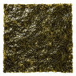

# Kim

**Kim** is a modular, Rust-native platform of small, beautiful, ultra-light tools that work
equally well for humans and for AI agents. Kim is made by **mouv**.

**Subak** is the first Kim tool: a persistent, Windows-first terminal whose sessions live in a
background **Host** that survives closing any **Client** (GUI window, CLI, agent). Linux support
is planned but not implemented.

> Status: **pre-alpha, documentation stage.** No tool is usable yet. Nothing in this repository
> installs, updates, or starts software on your machine. See the [roadmap](#roadmap).

## What Kim is (and is not)

| Kim is | Kim is not |
| --- | --- |
| A catalog of independent native tools you install one by one, explicitly | A suite that installs everything at once |
| CLI-first, scriptable, with stable JSON output and exit codes | GUI-only software that agents cannot drive |
| Local-first: no account, no ads, no telemetry by default | A cloud service or an Electron app |
| Optional, restrained native GUI | A heavyweight always-on runtime or daemon |

Kim never installs or updates a tool unless you explicitly ask it to.

## Roadmap

| Milestone | Goal | Status |
| --- | --- | --- |
| **M1 – Kim Foundation** | Philosophy, engineering standards, architecture, design system, tool catalog, manual installer, headless CLI | In progress |
| **M2 – Subak MVP** | Host/Client terminal on Windows: ConPTY sessions, headless CLI, tabbed GUI, floating icon, restore after reboot, Claude status indicator | Planned |
| **M3 – Parity expansion** | Broader tmux command/key compatibility, Tabby-class features (profiles, SSH, file transfer), MCP server | Planned |
| **M4 – Linux** | Linux ports of Kim and Subak | Planned |

Exact requirements and their milestones live in
[docs/PRODUCT_REQUIREMENTS.md](docs/PRODUCT_REQUIREMENTS.md).

## Documentation

Start with the [documentation index](docs/README.md):

- [Kim philosophy](docs/KIM_PHILOSOPHY.md)
- [Subak philosophy](docs/SUBAK_PHILOSOPHY.md)
- [Product requirements](docs/PRODUCT_REQUIREMENTS.md)

Contributors and coding agents must read [AGENTS.md](AGENTS.md) first.

## License

Not yet selected — license selection is tracked as part of the engineering-standards step.
Until a license file is added, all rights are reserved by the author.
