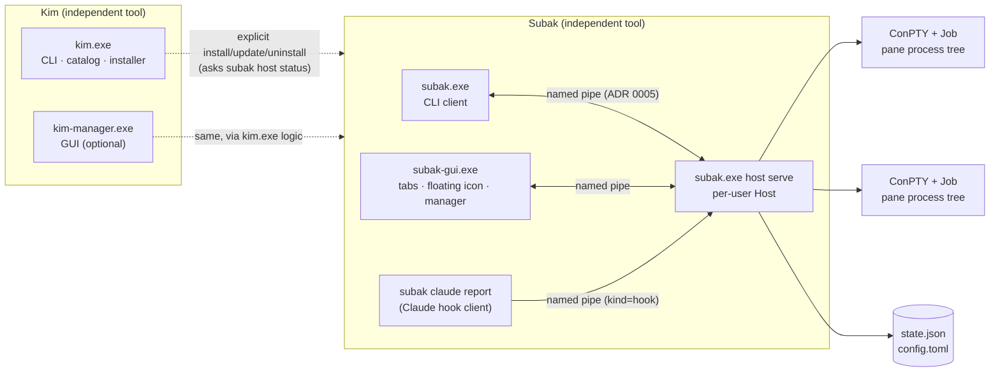
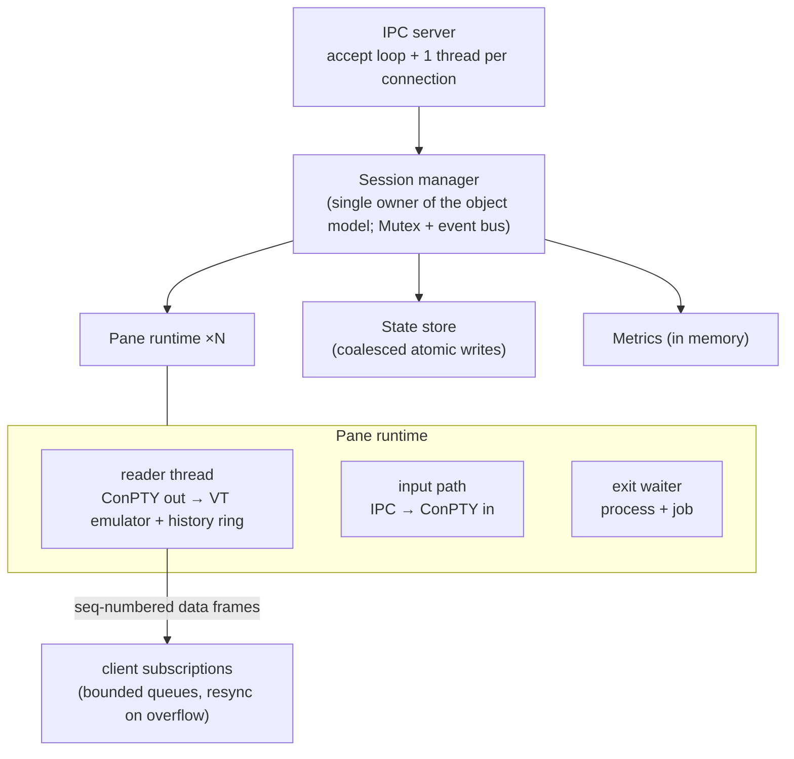
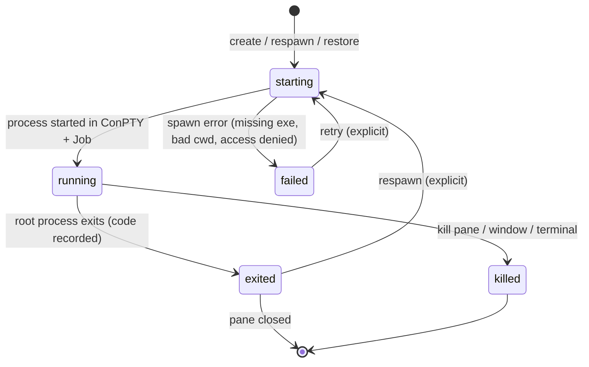

# Architecture

Status: **current** (design; components are implemented step by step — see §10) · Step 03

This document is the map; the reasons behind each choice are in the [ADRs](adr/README.md),
wire and storage formats in [contracts/](contracts/IPC_PROTOCOL.md), and known risks in the
[risk register](RISK_REGISTER.md).

## 1. System overview



- **Kim** and **Subak** are separate packages and binaries ([ADR 0002](adr/0002-independent-tool-binaries.md)).
  Kim touches Subak only through Subak's public CLI (`subak host status --json`) and the file
  system layout of its own installs.
- **Only the Host owns processes.** Every other box is a client that can disappear at any time
  without consequences for sessions.

## 2. Components

| Component | Binary / crate | Responsibility | Requirements |
| --- | --- | --- | --- |
| Kim CLI | `kim.exe` / `crates/kim` | Catalog queries, explicit install/update/uninstall, update check, tool discovery | KIM-FR-003…010, KIM-SEC-001…005 |
| Kim Manager GUI | `kim-manager.exe` (Step 06) | Same operations with a GUI; never runs headless paths through the GUI | KIM-FR-009, KIM-FR-013 |
| Subak CLI | `subak.exe` / `crates/subak` | Terminal CRUD, attach/detach, capture, host control, Claude hook reporter | SUBAK-FR-011…015, SUBAK-FR-053 |
| Subak Host | `subak.exe host serve` | Owns Terminals/Windows/Panes, ConPTYs, jobs, VT state, history, state store, IPC server, metrics | SUBAK-FR-001…004, SUBAK-FR-016, SUBAK-FR-040 |
| Subak GUI | `subak-gui.exe` (Steps 16–18) | Tabbed terminal window, floating icon/tray, session manager; pure client | SUBAK-FR-030…035 |
| Subak MCP | later (Step 37) | Opt-in local MCP adapter over the same IPC | SUBAK-FR-062 |

### 2.1 Host internals



- **Concurrency model:** plain OS threads and channels. Blocked threads cost no CPU when idle;
  there are no polling loops or timers while idle (`KIM-NFR-001`). An async runtime may be
  introduced later only with measurements and an ADR.
- **Panic containment:** each connection and pane thread runs request handling inside
  `catch_unwind`; a panic fails that request/pane with `internal_error` and is logged without
  content, while other sessions continue.

## 3. Object model

Terminal → internal Window → Pane → process tree ([SUBAK_PHILOSOPHY §2](SUBAK_PHILOSOPHY.md),
[ADR 0007](adr/0007-object-identity-and-naming.md)).

| Object | Identity | Owns | Invariants |
| --- | --- | --- | --- |
| Terminal | `t-…` + unique case-insensitive name | ≥ 1 Window; profile; restore policy | Exactly one Host owns it; appears as one GUI tab |
| Window | `w-…` + index within Terminal + name | ≥ 1 Pane; layout tree; active pane | Belongs to exactly one Terminal |
| Pane | `p-…` + index within Window | one ConPTY, one Job, VT state, history ring | Belongs to exactly one Window; its process tree is in exactly its Job |

An object is never shared between Terminals; moving a pane (`join-pane`, Step 24/25) re-parents
it inside the same Host without restarting its process.

## 4. Lifecycles

### 4.1 Pane process



### 4.2 Terminal

| State | Meaning | How it is entered | Allowed operations |
| --- | --- | --- | --- |
| `running` | ≥ 1 pane process alive | create, start, restore | attach, input, rename, split, stop, kill |
| `stopped` | Terminal kept, no live process (all exited with remain-on-exit, or `subak stop`) | last process ends while kept; explicit stop | start (respawn panes), rename, delete |
| `restorable` | Loaded from state after a Host restart/reboot; old processes are gone | Host start with persisted Terminals | restore (dry-run or confirmed), rename, delete |
| `failed` | Last start/restore failed; reason kept | spawn failure | retry, edit profile, delete |
| `unknown` | State cannot be trusted (e.g. written by a newer Subak version) | Host start with unreadable/newer state | inspect, delete only with `--force` |

A Terminal whose last pane exits **without** remain-on-exit is removed (tmux semantics);
with remain-on-exit it becomes `stopped`. Nothing ever goes from `restorable` to `running`
without an explicit user action or an explicit per-Terminal auto-restore opt-in
(`SUBAK-SEC-002`).

### 4.3 Host

```mermaid
stateDiagram-v2
  [*] --> starting: client finds no Host → start lock → spawn detached
  starting --> serving: pipe created (first instance), state loaded
  starting --> [*]: another Host won the race (exit quietly)
  serving --> idle_grace: 0 live Terminals AND 0 clients
  idle_grace --> serving: client connects / Terminal created
  idle_grace --> [*]: grace period elapsed (persist + exit)
  serving --> stopping: subak host stop (refused if live Terminals unless --kill-terminals)
  stopping --> [*]: state persisted, panes ended
  serving --> [*]: logoff / shutdown / crash (all panes end; restore later)
```



### 4.4 Client connection

`connecting → handshake (≤ 5 s) → ready → [subscribed to events / attached to panes] →
closed`. A client's disappearance at any point only removes its subscriptions; if it was the
pane's size owner, the next most recently active client becomes owner
([ADR 0008](adr/0008-attach-replay-and-backpressure.md)).

## 5. Operation semantics: detach vs close vs stop vs kill vs delete

| Intent | CLI | GUI | Processes | Stored Terminal |
| --- | --- | --- | --- | --- |
| Stop looking | `subak detach`, `Ctrl+B d`, close console window | close window / quit / `Ctrl+B d` / crash | unaffected | unaffected |
| Look again | `subak attach <target>` | open tab / session manager | unaffected | unaffected |
| Hide one tab | — | tab menu "Hide tab" | unaffected | unaffected |
| End processes, keep Terminal | `subak stop <t>` (graceful, then forced after timeout) | session manager "Stop" | ended | kept as `stopped` |
| End Terminal (tmux kill-session) | `subak kill <t>` (`--force` needed non-interactively when busy) | `Ctrl+W` / "Close Terminal" (confirms when busy) | ended | removed |
| Remove a dead Terminal record | `subak rm <t>` (only `stopped`/`restorable`/`failed`) | session manager "Delete" | none running | removed |
| Kill pane / window | `subak kill <t:w.p>` | `Ctrl+B x` / `Ctrl+B &` (confirm) | that pane/window only | topology updated |

"Graceful" = `ClosePseudoConsole` (processes receive `CTRL_CLOSE_EVENT`), wait up to 5 s,
then `TerminateJobObject`. "Force" skips the wait. Every destructive CLI command supports
`--dry-run` (prints exactly which objects and how many processes would end).

## 6. Disconnect, restart and version behavior

| Event | Host | Clients | Sessions |
| --- | --- | --- | --- |
| Client exits/crashes/closes window | drops its subscriptions; reassigns size owner | — | unaffected |
| Host crashes | — | GUI shows "Host disconnected", reconnects with backoff (0.5 s → 5 s); CLI attach exits with `host_disconnected` | all processes end (Job kill-on-close); next Host start marks Terminals `restorable` |
| Logoff / shutdown / reboot | ends | end | as above; restore offered later |
| Sleep / hibernate / lock / RDP disconnect | keeps running | reconnect if their pipe broke | unaffected; **no restore, no duplicates** (`SUBAK-FR-044`) |
| Client newer than Host (protocol minor) | serves common features | hides unsupported features | unaffected |
| Protocol major mismatch | rejects handshake (`protocol_unsupported`) | explains; never restarts the Host automatically | unaffected |
| Subak updated while Host runs | keeps running old version | `subak host status` shows host vs client version | unaffected until the user chooses to restart the Host |

## 7. Key data flows

```mermaid
sequenceDiagram
  participant C as subak attach (client)
  participant H as Host
  participant P as Pane runtime
  C->>H: hello {protocol 1..1, kind cli}
  H-->>C: welcome {protocol 1, features}
  C->>H: pane.attach {target, interactive, size}
  H->>P: lock; snapshot VT state @ seq N; subscribe from N+1
  H-->>C: result {snapshot (VT bytes), seq N}
  P-->>C: data frames seq N+1, N+2, ...
  C->>H: data frame (input bytes)
  H->>P: write to ConPTY input
  Note over C,H: client closes window → pipe breaks → Host drops subscription only
```

Create Terminal: `terminal.create {name?, profile?, command?, cwd?, env?}` → session manager
validates name → allocates IDs → spawns pane (state `starting`) → persists → emits
`terminal.created` → responds with IDs. Failure to spawn yields `failed` with a structured
`spawn_failed` error; no half-created Terminal remains unless `--keep-on-failure`.

## 8. Performance telemetry (local only)

Metrics are defined in [ADR 0012](adr/0012-local-metrics-no-telemetry.md) and read with
`subak host stats --json`. Measurement method for budgets in
[PRODUCT_REQUIREMENTS §3.2](PRODUCT_REQUIREMENTS.md):

| Budget | Measured as | Method |
| --- | --- | --- |
| Idle CPU (`KIM-NFR-001`) | Host process CPU time delta over 60 s with N idle Terminals, no clients | `GetProcessTimes` sampled by the harness; machine/OS recorded |
| Memory (`KIM-NFR-002`) | Host private working set with N idle panes, excluding child processes | `GetProcessMemoryInfo` |
| Attach latency | `pane.attach` request → snapshot received | client-side monotonic clock; p50/p95 over 100 attaches |
| Keystroke echo latency | input frame sent → corresponding output frame received (echo in `cmd /k`) | client-side, p95 |
| Throughput | bytes/s sustained from `type`-ing a large file with 0, 1, 3 clients | Host counters |
| State write cost | `state.write_latency_us` p95 | Host histogram |

No metric includes content, names, paths or command lines (`KIM-SEC-012`).

## 9. Portability

Platform-specific code is confined to five interfaces — `Pty`, `ProcessTree`, `IpcTransport`,
`Paths`, `SecretStore` ([ADR 0011](adr/0011-portability-boundary.md)). On non-Windows targets
they return `unsupported_platform` until milestone M4.

## 10. Implementation status

| Area | Status | Step |
| --- | --- | --- |
| Workspace, CI, placeholder binaries | implemented | 02 |
| This architecture, ADRs, contracts | current (design) | 03 |
| Design system, GUI toolkit ADR | planned | 04 |
| Kim catalog (signed, offline, read-only CLI + explicit refresh) | implemented | 05 |
| Kim installer / manager GUI / CLI contract | planned | 06–07 |
| ConPTY + detached Host proof | planned | 08 |
| IPC v1, supervisor | planned | 09 |
| Session lifecycle, PTY management, CLI, replay | planned | 10–14 |
| GUI, tabs, floating icon | planned | 15–20 |
| Windows/panes, layout, tmux engine | planned | 21–26 |
| Claude integration, persistence, recovery | planned | 27–31 |
| Profiles, SSH, extended features | planned | 32–36 |
| MCP, interoperability, hardening, release | planned | 37–40 |
| Linux | planned | 41–42 |
