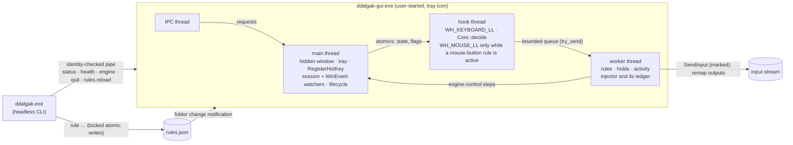

# Ddalgak engine (Steps 66–69)

Status: **current** (engine implemented in Step 66 for Windows, the rule store and live reload in
Step 67, §10; remaps, blocks and mouse-button triggers in Step 68, §11; sent keys, typed text,
paste and hotstrings in Step 69, §12; the other actions follow in Steps 70–72) · Decisions:
[ADR 0022](adr/0022-ddalgak-rule-model-and-safety.md),
[ADR 0024](adr/0024-ddalgak-windows-input-apis-and-permissions.md),
[ADR 0028](adr/0028-ddalgak-rule-store-validation-and-reload.md),
[ADR 0031](adr/0031-ddalgak-remap-execution-and-mouse-hook.md),
[ADR 0034](adr/0034-ddalgak-typing-runs-hotstrings-and-clipboard.md) · Code: `crates/ddalgak` ·
Requirements: `DDALGAK-FR-001…010`, `DDALGAK-FR-017`, `DDALGAK-FR-020`, `DDALGAK-FR-060`, `DDALGAK-FR-071`,
`DDALGAK-FR-011`, `DDALGAK-FR-012`, `DDALGAK-FR-070`, `DDALGAK-NFR-001`, `DDALGAK-NFR-002`,
`DDALGAK-NFR-004`, `DDALGAK-SEC-001…005`, `DDALGAK-SEC-007`, `DDALGAK-SEC-010`, `DDALGAK-SEC-011`

This document describes what the Ddalgak engine does today, how it is built, how to drive it
from the CLI, what was measured and what was verified on real Windows. The *why* is in the ADRs;
the rule format is [DDALGAK_RULE_MODEL](DDALGAK_RULE_MODEL.md); the safety scope is
[DDALGAK_SAFETY](DDALGAK_SAFETY.md).

## 1. What Step 66 delivers, and what it does not

| Delivered | Not yet (owner Step) |
| --- | --- |
| `ddalgak-gui.exe`: the tray app that owns the engine (tray icon with state by shape and text, single instance per user session, hidden window, no editor) | the rule editor and playground windows (74, 76) |
| The low-level keyboard hook engine: event model, trigger tables, decision core, worker, lifecycle, emergency chord, held-key ledger, rate limit, stepping aside; since Step 68 remaps and blocks, mouse-button triggers with the on-demand mouse hook (§11); since Step 69 sent keys, typed text, paste with clipboard restore and hotstrings (§12) | launches (70), mouse actions and wheel triggers (71), modes (72), ordered multi-step runs (78) |
| Ddalgak's own global shortcuts `engine.toggle` and `engine.pause` from `hotkeys.json`, registered with `RegisterHotKey` | the `ddalgak hotkeys …` commands (81; bind by editing `hotkeys.json` until then) |
| Rules: the engine runs **engine-control rules** (`engine` steps), since Step 68 **remap** and **block** rules (§11), since Step 69 **`send_keys`**, **`type_text`** and **hotstring** rules (§12), and keeps every other rule inactive with a stated code; since Step 67 the rule store with full validation, CRUD, drafts, history and live reload (§10) | the other action types (70–72, 78) |
| `ddalgak status`, `health`, `engine start|pause|resume|stop`, `pause`, `resume`, `quit`, `startup status|enable|disable`, `capabilities` with `--json` and `--dry-run`; since Step 67 `rule …` and `rules …` | `profile`, `mode`, `test`, `explain` (72, 75, 76, 77, 81) |
| Opt-in start at sign-in through the user's Run key | — |

**Never broader.** A rule this version does not run is listed in `status` as inactive with its
code: `step_unsupported` (an action type of a later Step — launches in 70, mouse actions in 71,
modes in 72, `delay` and a typing step among other steps in 78 — or an unknown one),
`condition_unsupported` (`when`, Step 77), `rule_unsupported` (an unknown field inside the rule),
`trigger_invalid`/`trigger_reserved`, `duplicate_rule_id`, `duplicate_trigger` and every other
error of DDALGAK_RULE_MODEL §8. A file that is not a usable `ddalgak.rules` v1 document is not
loaded at all and the engine cannot be turned on with it (`rules_invalid`,
`rules_from_newer_version`). `rules.json` is read again at every `engine start` and reloaded
while the app runs (§10); the app itself never writes it.

## 2. The event model

Each `KBDLLHOOKSTRUCT` becomes a `RawKey` and then a normalized `KeyEvent`
(`crates/ddalgak/src/event.rs`):

| Field | Meaning |
| --- | --- |
| `vk` | Virtual key; side-specific for modifiers (`VK_LSHIFT`, `VK_RCONTROL`, …; generic codes from injected input are resolved by scan code or the extended flag). Logical triggers (`J`, `F13`) match it; Windows assigns it per layout, so `Ctrl+Z` on QWERTZ is the key labeled Z. |
| `scan`, `extended` | The position. Physical triggers (`code:KeyZ`) match the scan code, whatever the layout. |
| `transition` | `Down`, `Repeat` (a down for a key that is already down) or `Up`. Holds are timed by the worker from the down. |
| `source` | `physical`, `injected_by_ddalgak` (`LLKHF_INJECTED` + the `dwExtraInfo` marker) or `injected_by_other_program`. |
| `device` | `unknown` for physical keys (the low-level hook does not identify keyboards), `synthetic` for injected ones. |
| `modifier`, `altgr_fake_ctrl` | Which of the eight modifier keys this is; the fake left Ctrl (scan `0x21D`) that precedes Right Alt on AltGr layouts. |

Modifier matching is exact (HOTKEY_CONTRACT §5.5): generic modifiers accept either side,
side-specific ones need that side, nothing else may be held, `Win` is never part of a trigger,
and AltGr is its own modifier (`AltGr+Q` ≠ `Ctrl+Alt+Q`). The normalizer keeps only the
current key state; nothing is recorded (`DDALGAK-SEC-001`).

**Mouse buttons** (Step 68). While the low-level mouse hook is installed (§11), middle and X
button events become `RawKey`s with the documented `VK_MBUTTON`, `VK_XBUTTON1` and `VK_XBUTTON2`
codes (a keyboard never sends them) and go through the same normalizer and core; moves, the wheel
and the primary and secondary buttons pass on without reaching the core.

**IME and layouts.** No character translation happens in the hook (dead keys stay intact).
While an IME window reports a composition (`EVENT_OBJECT_IME_SHOW`), no rule fires and keys pass
(`skipped_ime_composition`); IMEs that compose inline without an IME window may not report it,
which is left to the manual checks with the Korean IME (§11, §12). Layout switches change nothing
in the rules. Since Step 69, and only while a hotstring rule is active, keys that reach the
application unchanged are translated to characters with the foreground layout's `ToUnicodeEx`
and its "keyboard state is not changed" flag (§12).

## 3. The decision pipeline

`Core::decide` (`crates/ddalgak/src/core.rs`) runs inside the hook callback, allocation-free,
over a table compiled when the engine starts (`crates/ddalgak/src/table.rs`):

1. **Emergency chord** `Ctrl+Alt+Shift+Escape`, any order, on *physical* modifier state (AltGr's
   fake Ctrl counts as Ctrl). The event passes on, the engine state flips to off in the callback,
   the hook is removed right after it, held keys are released, the emergency marker is written
   and a tray notice explains it. Injected modifiers or an injected Escape never count.
2. **Own input** passes untouched and is never matched (two rules that point at each other are a
   swap, not a loop).
3. **Consumed down, consumed up**: a key-up and its auto-repeats are consumed exactly when the
   key-down was; a reload keeps the pairs.
4. **Candidates** in precedence order (mode-scoped first, then `priority`, then file order).
   Other programs' input only reaches `injected: accept` rules (`skipped_injected_input`
   otherwise). While paused only engine-control rules remain (`skipped_paused`).
5. **Stepping aside**: session locked or secure desktop (`skipped_secure_desktop`), a Win32
   password edit has focus (`skipped_password_field`), an IME composition
   (`skipped_ime_composition`), an elevated foreground window for injecting rules
   (`skipped_elevated_target`). The key passes unchanged.
6. **Triggers**: `press` (consumed unless `pass_through`), `release` (a tap with no other key in
   between; a bare modifier's down and up always pass so it keeps working in chords), `hold`
   (armed on down, fired by the worker after `hold_ms` unless released), `repeat: true`, and
   sequences of up to four chords (`Escape`, a non-matching step or a focus change cancel;
   pending steps are swallowed as the contract says).
7. **Rate limit** per rule (`max_runs_per_second`, default 20): runs beyond it are dropped with
   `rate_limited`, which stops storms of auto-repeat and loops through other programs.

Widened matching for `remap`/`block` (a trigger without modifiers matches with modifiers held,
except where that forms a reserved chord: with `Tab` remapped, `Alt+Tab` still switches
windows) runs since Step 68; an exact chord of another rule wins over a widened match. Remaps
themselves are §11.

## 4. Process, threads and lifecycle



| State | Hook | How to get there |
| --- | --- | --- |
| `off` | none | app start (default), `ddalgak engine stop`, tray, `engine.toggle`, an engine-control rule (`disable`), the emergency chord, app exit |
| `running` | installed | `ddalgak engine start`, tray, `engine.toggle`, `engine_on_start: on` at a clean start; `resume` from paused |
| `paused` | installed (only engine-control rules run) | `ddalgak pause`, tray, `engine.pause`, a rule (`pause`, `toggle_pause`) |

- **Start policy** (`DDALGAK-FR-003`): off unless `engine_on_start: on`; always off, with a
  notice, after an unclean exit (the run marker `%LOCALAPPDATA%\mouv\ddalgak\engine.running` was
  left behind), after an emergency off (`engine.emergency`), with `--no-hotkeys`/`KIM_NO_HOTKEYS`,
  or when the app runs elevated. `status` reports the reason as `start.off_reason`.
- **No rule turns the engine on** (`DDALGAK-FR-004`); the lifecycle refuses it.
- **Held keys** are released on pause, stop, emergency, session lock or disconnect, shutdown,
  `Drop` and in the panic hook (`DDALGAK-SEC-005`); since Step 68 the worker owns the injector
  and its ledger (keys and mouse buttons), the hook thread tells it to release everything when it
  drops its remaps, and an elevated window taking focus releases too (§11). After a desktop switch (lock screen, UAC,
  Ctrl+Alt+Del) or an unlock the hook forgets its key state, so a key-up it never saw (the
  `Win` of `Win+L`) cannot block every trigger afterwards (unit-tested; the switch events
  themselves are **not tested** on this machine).
- **Single instance** per user session (named mutex with the user SID in `Local\`, plus the
  pipe's first instance): a second `ddalgak-gui.exe` exits with `app_already_running` (7).
- **Sign-in start** (opt-in): `ddalgak startup enable` writes
  `HKCU\Software\Microsoft\Windows\CurrentVersion\Run\mouv.ddalgak` =
  `"<folder>\ddalgak-gui.exe" --startup`; `disable` removes it. No service, task or daemon.
- **Visibility**: the shipped app always shows its tray icon. The debug-only **test host**
  (`ddalgak-gui --test-host`, compiled out of release builds) has no tray icon, never consumes a
  key, and ends by itself; the automated tests use it.

## 5. Ddalgak's own shortcuts

`hotkeys.json` (`%APPDATA%\mouv\ddalgak\hotkeys.json`, hotkey contract v1) binds Ddalgak's GUI
actions; all ship unbound. Example:

```json
{ "schema": "kim.hotkeys", "schema_version": 1, "tool": "ddalgak",
  "overrides": [ { "action": "engine.toggle", "bindings": ["Ctrl+Alt+Shift+F9"] },
                 { "action": "engine.pause",  "bindings": ["Ctrl+Alt+Shift+F10"] } ] }
```

The app registers `engine.toggle` and `engine.pause` with `RegisterHotKey` at start, so they work
while the hook is off. `status` shows each as `registered`, `taken` (another program owns it;
nothing is retried or stolen), `unsupported` (left/right modifiers or `code:` keys, which
`RegisterHotKey` cannot express) or `unavailable` (`editor.open` before Step 74). An invalid file
is safe mode: nothing is registered.

## 6. CLI

`ddalgak --help` is the reference; every `--json` document is specified by
[ddalgak-cli-v1](contracts/schemas/ddalgak-cli-v1.schema.json) (examples from real runs in
`contracts/examples/ddalgak-cli-v1/`).

| Command | Effect | Notes |
| --- | --- | --- |
| `status` | read | Works without the app (then from the files, `engine.off_reason: app_not_running`). Activity names rule IDs and outcome codes only. |
| `health` | read | Needs the app. Hook installed/thread alive, callback timing, late events, dropped signals, panics, wake-ups, CPU time; `healthy` and `problems`. |
| `engine start` (`engine on`) | write, `--dry-run` | Re-reads `rules.json`. Refused: `rules_invalid` (4), `rules_from_newer_version` (5), `engine_elevated` (5), `hook_failed` (1). |
| `engine pause` / `pause` | write, `--dry-run` | `engine_off` (7) when off. |
| `engine resume` / `resume` | write, `--dry-run` | Never turns an engine on that is off. |
| `engine stop` (`engine off`) | write, `--dry-run` | Removes the hook. |
| `quit` | write, `--dry-run` | Ends the tray app (engine off first). |
| `startup status|enable|disable` | read / write, `--dry-run` | The user's Run value only. |
| `capabilities` | read | [tool-capabilities-v1](contracts/schemas/tool-capabilities-v1.schema.json) |
| `rule list|show|check`, `rule add|edit|delete|duplicate|enable|disable|move|revoke`, `rules history|backup|restore|reload|draft` | read / write / destructive | Step 67, §10. They work without the app (only `rules reload` needs it); after a saved change they ask a running app to reload. |

Every command that talks to the app first checks that the pipe is served by `ddalgak-gui.exe` of
the same user (`app_identity_mismatch`, 4) and sends nothing otherwise. Without the app it fails
with `engine_not_running` (3); the CLI never starts the app, installs a hook, opens a window or
shows a tray icon (`DDALGAK-FR-060`). Error codes: [CLI_CONTRACT §6](CLI_CONTRACT.md).

## 7. Measurements

Machine: Windows 10 Pro 19045, the maintainer's PC (shared, often locked during the run).
Numbers are local measurements (ADR 0012), never sent anywhere.

| What | Method | Result |
| --- | --- | --- |
| Decision cost, 1000 rules, key no rule uses (full scan) | `core::tests::decision_cost_with_1000_rules_…`, 20 000 calls | **0.28 µs** per event (release), 2.3 µs (debug) |
| Compiling 1000 rules into a table | same test | 31 µs (release), 155 µs (debug) |
| Installing the hook | `tests/hook_windows.rs` | 0.16–0.32 ms (debug) |
| `engine start` through the CLI (IPC round trip, rules load with 100 rules, hook install) | benchmark script below | 20 ms (debug) |
| **Idle, engine on, 100 rules, 60 s, no input** | debug test host; `ddalgak health` before and after; `GetProcessTimes` and Ddalgak's own wake-up counters | **CPU 0 ms** (below the 15.6 ms timer resolution, i.e. < 0.026 % of one core); hook-thread wake-ups **0**; worker wake-ups **0**; app main-thread wake-ups 1 (the second `health` request itself) |
| Idle, hook installed, 2 s, in-process | `tests/hook_windows.rs` | hook-thread wake-ups 0, worker wake-ups 0, CPU 0 µs |
| Hook callback time with real input | `tests/hook_windows.rs` (p99 bucket and maximum from the callback's own timing) | asserted p99 ≤ 1 ms when the desktop stays unlocked for the run (not observed yet, §8); the decision itself is the 0.28 µs above |

Method of the idle benchmark (reproducible): build the debug binaries, write a `rules.json` with
100 engine-control rules on `F13`–`F24` with modifier combinations into a sandbox `%APPDATA%`,
start `ddalgak-gui --test-host --endpoint <name>` with that environment, `ddalgak engine start`,
read `ddalgak health --json`, wait 60 s without input, read it again and subtract
`process.cpu_ms` and `counters.wakeups.*`. The engine has no timer: threads wake only for input,
posted messages and IPC requests. `DDALGAK-NFR-001` (< 0.1 % over 60 s with 100 rules) is met by
this run; the release tray app is measured in Step 82 (its tray icon cannot be shown on the
maintainer's desktop during automated runs).

## 8. Verification status on real Windows

| Check | Status | Evidence |
| --- | --- | --- |
| Hook installs, observes, unhooks on stop, on the watchdog timeout and while unwinding a panic | **tested** (Windows 10 19045) | `tests/hook_windows.rs` |
| No idle wake-ups or CPU with the hook installed | **tested** | §7 |
| Own injected input is never matched | **tested** with real `SendInput` (40 marked events, all seen as Ddalgak's own, none fired a rule that accepts injected input) | `tests/hook_windows.rs` |
| Other programs' injected input reaches only `injected: accept` rules | **tested** through the real app (below) | `tests/cli.rs` |
| Held keys released by `release_all` and on drop (checked with `GetAsyncKeyState`), a 40-event storm through "another program" cut by the rate limit, p99 callback time with real input | **attempted, not observed**: in every run `SendInput` was refused before these steps (the shared workstation was locked, or an elevated window had focus), so the test reported `skipped (SendInput refused)`; the logic is unit-tested (`inject`, `core`). Re-run `cargo test -p ddalgak --test hook_windows -- --nocapture` on an unlocked desktop | `tests/hook_windows.rs` |
| The real app: an injected `F13` fires an engine-control rule (paused), it works while paused (resumed), `F14` turns the engine off and the hook is removed | **tested** (one unlocked run on this machine) | `tests/cli.rs::injected_input_reaches_only_accepting_rules_in_the_real_app`, example `status-paused-by-rule.json` |
| `RegisterHotKey` registration of `engine.toggle`/`engine.pause` (`Ctrl+Alt+Shift+F13/F14`) in the running app | **tested** (`registered`) | `tests/cli.rs::the_app_lifecycle_through_the_cli` |
| **Pressing** a registered shortcut toggles the engine with no window open | **not tested**: pressing it needs `Alt` held, and tests may inject only F13–F20 on this shared machine | manual steps below |
| Emergency chord with physical keys | **not tested** (must not be injected; physical keys only): core unit tests cover it; real-keyboard check below and in Step 73 | manual steps below |
| Tray icon and menu | **not tested** (would show on the maintainer's desktop); icons are built in a test without showing | manual steps below |
| Password edit detection | **tested** on a hidden Win32 edit with `ES_PASSWORD` (not focused); focus-driven behavior **not tested** | `win::context` tests |
| IME composition guard with the Korean IME, elevated-window skipping | **not tested** (no Korean IME test setup; no injecting rule exists yet) | Steps 68–70 |
| Session lock releases keys and stops rules | **not tested** (needs a lock/unlock during a run) | Step 73 |
| Single instance, start policy markers, invalid rules, pipe squatter, private Run key | **tested** | `tests/cli.rs` |
| Elevated app refuses to turn the engine on | implemented; the tests take an elevated branch that asserts `engine_elevated` when they run as administrator (as on CI runners); **not run elevated on this machine** (no elevation, AGENTS.md §5) | `tests/cli.rs` |

**Manual check for the maintainer** (about five minutes; uses the release build and shows the
tray icon on your desktop):

1. `cargo build -p ddalgak --release`.
2. Create `%APPDATA%\mouv\ddalgak\hotkeys.json` with the example of §5 (`Ctrl+Alt+Shift+F9`
   toggles, `Ctrl+Alt+Shift+F10` pauses).
3. Start `target\release\ddalgak-gui.exe`. A ring icon appears in the notification area; its
   tooltip says "Ddalgak: engine off". No window opens.
4. Press `Ctrl+Alt+Shift+F9`. The icon becomes a filled disc ("engine on");
   `target\release\ddalgak status` shows `engine: running` and the last change
   `shortcut:engine.toggle`. Type in any program: nothing changes (no rule consumes keys).
5. Press `Ctrl+Alt+Shift+F10`: two bars ("paused"); again: the disc.
6. Press `Ctrl+Alt+Shift+Escape`. The icon becomes the ring and a notice says the emergency
   chord turned the engine off; `ddalgak status` shows `off (emergency)` after the next start.
7. Right-click the icon: the menu turns the engine on and off and quits. Quit, start the app
   again: the engine stays off and a notice names the emergency.
8. `target\release\ddalgak startup enable`, sign out and in: the tray icon is back, engine off;
   `ddalgak startup disable` removes the Run value.

## 9. Files

| Path | What |
| --- | --- |
| `crates/ddalgak/src/{event,trigger,table,core,worker,lifecycle,inject,shortcuts,rules,ipc,startup,stats}.rs` | portable engine, unit-tested on every platform |
| `crates/ddalgak/src/remap.rs` | remap outputs (`Output`), the playground preview, the editor's summary sentence and form fields (Step 68, §11) |
| `crates/ddalgak/src/{text,hotstring,run}.rs` | typed text (encoding, variables, insertion point, previews, the text editor's data model), the hotstring matcher and its bounded buffer, typing runs with their target checks, clipboard handling and fakes (Step 69, §12) |
| `crates/ddalgak/src/{model,schema,validate,store,edit}.rs` | the rule store (Step 67, §10): typed model, run-time schema, validation, files, operations |
| `crates/ddalgak/src/win/{hook,inject,context,host,tray,pipe,instance,startup,watch,typing}.rs` | Windows layer (`watch`: the folder change notifications of §10; `typing`: key translation, the target probe, the clipboard and the local clock of §12) |
| `crates/ddalgak/src/main.rs`, `cli.rs`, `output.rs`, `rule_cmd.rs` | the `ddalgak` CLI (`rule_cmd`: the `rule` and `rules` commands) |
| `crates/ddalgak/src/bin/ddalgak-gui.rs` | the tray app |
| `crates/ddalgak/hotkeys.manifest.json` | the built-in hotkey manifest (equal to the contract example) |
| `crates/ddalgak/tests/{cli,hook_windows}.rs` | real-binary and real-hook tests |
| `e2e/tests/step66_ddalgak_engine.rs`, `e2e/tests/step67_ddalgak_rules.rs`, `e2e/tests/step68_ddalgak_remap.rs`, `e2e/tests/step69_ddalgak_typing.rs` | the e2e scenarios (run only through `cargo xtask e2e`) |

## 10. The rule store and live reload (Step 67)

Decision: [ADR 0028](adr/0028-ddalgak-rule-store-validation-and-reload.md). Format and codes:
[DDALGAK_RULE_MODEL §2, §8, §13](DDALGAK_RULE_MODEL.md).

**Files** (`%APPDATA%\mouv\ddalgak\`): `rules.json` (saved), `rules.json.bak` (the version before
the last change), `history\<UTC time>-r<revision>.json` (every change, the last 50; `rules backup`
adds one on demand), `rules.draft.json` (an unsaved draft), `rules.json.lock` (the writers'
lock), `rules.json.tmp` (only while a save runs, or after a crash), `rules.corrupt-<time>.json`
(an unusable file a restore replaced).

**Three states, shown apart.** *Saved* is `rules.json`; *active* is what the running app holds
and the engine runs (the last usable file it read); *draft* is `rules.draft.json`. `ddalgak status`
reports `rules.saved` (file state, revision, `interrupted_save`), `rules.active_set` (revision and
load time; `null` without the app), `rules.in_sync`, `rules.last_reload` (`applied` or
`kept_previous` with the reason) and `rules.draft` (base revision, `stale`).

**Writing** (CLI; the editor in Step 74 uses the same store): lock → re-read → revision check →
change → validate before and after (an introduced error refuses the change) → `.bak` → temporary
file, flush, rename → history snapshot → unlock → ask a running app to reload. Two CLIs at once
take turns; a writer killed half-way leaves the previous `rules.json` and its lock is released by
the OS.

**Reloading** (the app): a folder change notification (one waiting thread, no polling) or the
CLI's `rules.reload` request makes the app read `rules.json` and compare its bytes with the
active ones. A usable, changed file becomes active at once: with the engine on, a new table is
swapped into the running hook between two callbacks (the hook stays installed, keys it consumed
stay paired, pending taps, holds and sequences are dropped) and the worker gets the new rules
with a new generation, so signals of the old table are ignored. An unusable file keeps the active
rules, marks `in_sync: false`, sets `last_reload.outcome: kept_previous` with `rules_invalid` or
`rules_from_newer_version`, adds `rules_invalid` to `health.problems` and shows one tray notice per
bad version. The engine state (off, running, paused) never changes by a reload.

| Check | Status | Evidence |
| --- | --- | --- |
| CRUD, offers, refusals, consent, drafts, history, backup, restore through the real CLI without the app | **tested** | `tests/cli.rs::rules_are_managed_through_the_cli_without_the_app` |
| Eight CLIs adding rules at once, six renaming one rule at once: no lost change; a held lock gives `busy` | **tested** | `tests/cli.rs::two_clis_editing_at_once_never_lose_a_change` |
| A writer killed half-way through writing `rules.json` (debug test hook): previous file intact, torn temporary file reported, next save works | **tested** | `tests/cli.rs::a_crash_in_the_middle_of_a_save_leaves_a_valid_file` |
| A corrupt file: safe mode, never rewritten, restore keeps it as `rules.corrupt-*.json` | **tested** | `tests/cli.rs::a_corrupt_file_is_safe_mode_kept_and_restorable` |
| Read-only `rules.json` and a folder the user may not add files to (`icacls` deny, no elevation): `permission_denied`, nothing changed | **tested** | `tests/cli.rs::read_only_files_and_folders_are_refused_and_left_alone` |
| Reload in the running app with the engine on: a CLI change is applied at once, a broken file keeps the previous rules, the hook stays installed and healthy, a repair is applied again | **tested** (Windows 10 19045; with the engine off when the tests run elevated) | `tests/cli.rs::a_running_app_reloads_valid_rules_and_keeps_its_hook` |
| A rule added while the engine runs fires through the swapped table in the same hook (real `SendInput` of `F17` as "another program") | **tested** on an unlocked desktop of this machine; reports **skipped** when the desktop is locked | same test |
| Load, validate and compile 1000 rules | **measured**: 33–34 ms (release, including compiling the schema's patterns once), 120–133 ms (debug); `DDALGAK-NFR-004` (< 100 ms with the hook, which installs in 0.2–0.3 ms) met | `rules::tests::loading_and_validating_1000_rules_is_fast_enough` |
| A reload while a remap holds a key | **tested** in the core and the worker (Step 68): the held output stays until its trigger goes up, an undecided dual role is dropped, the release after the reload frees the right key | `core::tests::a_reload_keeps_held_outputs_until_their_trigger_goes_up`, `worker::tests::a_reload_never_strands_a_held_output` |

## 11. Remaps, blocks and the mouse hook (Step 68)

Decision: [ADR 0031](adr/0031-ddalgak-remap-execution-and-mouse-hook.md). Format:
[DDALGAK_RULE_MODEL §3, §5.1, §5.2](DDALGAK_RULE_MODEL.md).

**What runs.** A `remap` rule makes its trigger act as another key, chord, modifier or mouse
button for exactly as long as it is held; `block` consumes its trigger. Both are widened (a plain
trigger matches with modifiers held, an exact chord of another rule wins, reserved and `Win`
chords never). Triggers can be keys, chords, lock keys, bare side-specific modifiers and the mouse
buttons `MouseMiddle`, `MouseX1`, `MouseX2`; outputs can be named keys (by virtual key, so the
layout decides), `code:` keys (by scan code), bare modifiers including `LWin`/`RWin`, and all five
mouse buttons.

**How.** The core keeps up to 16 held remaps and decides each output event from its key state;
the worker sends exactly what it was told with `SendInput`, marked as Ddalgak's own:

| Event | The core decides | The worker sends |
| --- | --- | --- |
| Trigger down | release the trigger's own modifiers (exact chord triggers, not with pass-through); press the target modifiers and key that nobody holds yet (reference counts; a key the user holds is left alone) | `Press`: ups of the released modifiers (not recorded), downs of the target (recorded in the ledger) |
| Auto-repeat | — | `Repeat`: the target key's down again, only while the ledger still holds it |
| Trigger up | release what this remap alone held; restore released trigger modifiers still held | `Release`: ups of the target, downs of the restored modifiers (not recorded) |
| Dual role (`tap`) | undecided until another key goes down (target first, that key held back and sent on after it), the hook thread's one-shot timer after `tap_ms`, or the trigger's up (the tap output) | `Press`/`Replay` or `Tap` (all in one `SendInput` call) |
| Pause, stop, session lock, profile switch | drop every remap, restore the user's still-held trigger modifiers | `ReleaseAll`, ordered after every press decided before; then `Restore` |
| Desktop switch, unlock, an elevated window takes focus | forget the key state (key-ups made there never reach the hook) and drop every remap | `ReleaseAll` |
| Reload | keep held remaps (their instructions carry the output keys), drop undecided dual roles | — |

The debug test host never injects (its worker's backend sends nothing): a remapped key pressed on
the real keyboard during an automated test types nothing.

**The mouse hook** (`WH_MOUSE_LL`, permission `mouse-hook`) is installed on the hook thread only
while the engine is on and an active rule has a mouse-button trigger, and removed when a reload,
a disable or a stop leaves none. `status` and `health` show `engine.hook.mouse_installed`. While it
exists the hook thread wakes for every mouse move (the callback passes moves on at once); without
a mouse rule the engine's idle cost is unchanged (§7).

**Measurements** (Windows 10 Pro 19045, this machine; numbers stay local, ADR 0012):

| What | Method | Result |
| --- | --- | --- |
| Decision cost, 1000 rules, a key no rule uses, with 0 and with 16 held remaps | `core::tests::decision_cost_with_1000_rules_…` and `…decisions_with_remaps_stay_far_below_the_hook_budget`, 20 000 calls | **0.66 µs** per event in a release build with or without held remaps, 2.5–2.7 µs in a debug build (measured while other builds ran on the machine; Step 66 measured 0.28 µs on an idle one) |
| Hook callback time with real remaps (injected obscure keys) | `tests/hook_windows.rs::real_remap_block_and_dual_role_with_obscure_keys`, the callback's own timing | max **85 µs**, p99 ≤ 100 µs (24 callbacks) |
| Trigger down to target down (worker wake-up and `SendInput`) | same test, polling `GetAsyncKeyState` every 2 ms | **2.6 ms** including the polling interval |
| Dual-role timer | same test, `tap_ms` 200 | target down **210 ms** after the trigger (thread timer resolution) |

**Verification on real Windows** (the shared machine; real-input tests inject only F13–F20 and no
mouse input; they report **skipped** when the workstation is locked):

| Check | Status | Evidence |
| --- | --- | --- |
| Press/repeat/release pairing, chord triggers releasing and restoring their modifiers, widening and exact-chord precedence, reserved and `Win` chords, left/right targets, consumed versus injected modifiers, shared outputs, keys the user holds, dual role (tap, timer, interrupt with replay, keys with their own rule, mouse never deciding), pass-through, block, mouse-button and `code:` targets, rate limits, swaps and chains that cannot loop, stepping aside, every release path, reloads | **tested** (decision core and worker, no input injected) | `core::tests` (Step 68 section), `worker::tests` |
| A remap `F15` → `F16` holds `F16` exactly while `F15` is held (repeat included), `F15` never goes down; `F17` blocked (down and up consumed); the pause path and the key-reset path release a held target; dual role `F18`: a tap sends `F20`, a hold presses `F19` after the tap time; nothing is left pressed | **tested** once on an unlocked desktop of this machine (`GetAsyncKeyState` of the test's own keys, the engine's counters); later runs reported **skipped (locked)** | `tests/hook_windows.rs::real_remap_block_and_dual_role_with_obscure_keys` |
| The mouse hook exists only while a mouse-button rule is active: absent without one, installed by the reload that adds one, removed when it is disabled and when the engine stops, installed at start when the rule exists | **tested** through the CLI and the test host (the hook passes every event on, nothing is injected) | `tests/cli.rs::the_mouse_hook_exists_only_while_a_mouse_button_rule_does` |
| Remaps refuse other programs' input (`skipped_injected_input`) and the test host injects nothing | **tested** in the core; in the real app by the e2e scenario (when it runs) | `core::tests::swapped_and_chained_remaps_never_loop`, `e2e/tests/step68_ddalgak_remap.rs` |
| CLI: remaps and blocks added, refused (primary-button or sequence mouse triggers, `Win` chords, self-remaps, dual role with pass-through, the Secure Attention Sequence as output, duplicate triggers) with nothing written | **tested** (unit tests, CLI tests, a manual run of the commands in a sandbox) | `edit::tests`, `tests/cli.rs`, `e2e/tests/step68_ddalgak_remap.rs` |
| **Typing with a physical keyboard** in normal applications and the shell, Korean 2-set IME (composition guard, `HangulMode` as an output), a layout switch (logical versus `code:` keys), Ctrl/Win/Alt combinations with remaps active, **real mouse buttons**, an elevated window taking focus while a remap holds its target, session lock while held, killing the app while held | **not tested**: physical keys, mouse buttons, the IME and elevation cannot be used by automated tests on this shared machine (AGENTS.md §5); the manual checks below | — |

**Manual checks for the maintainer** (about fifteen minutes; release build, the real tray app;
every rule below is removed again at the end):

1. `cargo build -p ddalgak --release`, start `target\release\ddalgak-gui.exe`, then
   `target\release\ddalgak engine start`.
2. Add the rules (each `rule add` also takes `--allow input-injection` for remaps):
   `ddalgak rule add --id caps --trigger CapsLock --action remap --to LCtrl --tap Escape --allow input-injection`,
   `ddalgak rule add --id hangul --trigger RAlt --action remap --to HangulMode --allow input-injection`,
   `ddalgak rule add --id jdown --trigger Ctrl+Shift+J --action remap --to Down --allow input-injection`,
   `ddalgak rule add --id x1 --trigger MouseX1 --action remap --to Alt+Left --allow input-injection`,
   `ddalgak rule add --id noins --trigger Insert --action block`. `ddalgak status` lists them
   active and shows `mouse hook installed`.
3. **Notepad**: CapsLock alone does not toggle caps; CapsLock+A selects all, CapsLock+C/V copy and
   paste, also when pressed quickly (within 200 ms); a quick tap of CapsLock acts as Escape (in a
   browser address bar it closes the suggestions); Shift+CapsLock acts as Shift+Escape; Insert does
   nothing, Shift+Insert does nothing either (widened block).
4. **PowerShell / cmd** in Windows Terminal: the same; Ctrl+Shift+J moves down in the command
   history like the Down key; holding it repeats; afterwards Ctrl and Shift are not stuck (type
   letters: they are not selected or uppercase).
5. **Korean IME** (add Korean 2-set if needed): Right Alt toggles 한/영 (the indicator changes);
   while composing a Hangul syllable, CapsLock is skipped (`ddalgak status` activity:
   `skipped_ime_composition`); Right Alt with an IME that composes inline: note whether it is
   skipped.
6. **Layout switch** (add German or US-International): `ddalgak rule add --id z --trigger code:KeyZ --action remap --to F16 --allow input-injection`
   acts on the key at the US Z position on both layouts; a logical `Z` rule follows the label.
7. **Combinations**: Alt+Tab still switches windows with a `Tab` remap; Win+CapsLock and Win+E
   still reach Windows; Ctrl+Shift+Escape opens Task Manager with an `Escape` remap; the emergency
   chord Ctrl+Alt+Shift+Escape turns the engine off while CapsLock is held (no key stays down).
8. **Mouse**: mouse button X1 goes back in a browser (Alt+Left); `ddalgak rule disable x1`, then
   `ddalgak status` shows the mouse hook removed; X1 works normally again.
9. **Elevated window**: open an administrator cmd yourself, hold CapsLock and click into it, let
   go, click back into Notepad and type: Ctrl must not be stuck.
10. **Lock**: hold CapsLock, press Win+L, unlock, type in Notepad: Ctrl must not be stuck.
11. **Kill** (known limit, Step 73): hold CapsLock and end `ddalgak-gui.exe` in Task Manager; if
    Ctrl then acts stuck, one press of a physical Ctrl clears it. Report what you see.
12. Remove the rules: `ddalgak rule delete caps hangul jdown x1 noins z --yes`, then quit the app.

## 12. Typed text, sent keys, paste and hotstrings (Step 69)

Decision: [ADR 0034](adr/0034-ddalgak-typing-runs-hotstrings-and-clipboard.md). Format:
[DDALGAK_RULE_MODEL §3.4, §5.3, §5.4](DDALGAK_RULE_MODEL.md).

**What runs.** `type_text` types its text (Hangul, emoji, new lines, tabs; optional date and time
variables and a `{cursor}` insertion point) as Unicode key events, or pastes it through the
clipboard; `send_keys` taps up to eight chords; a **hotstring** trigger (`btw` + space) erases the
abbreviation and runs one of them. Each is the rule's only step in this version.

**How.**

| Part | What it does |
| --- | --- |
| Core (hook thread) | Keys triggers fire as before. While a hotstring rule is active, a key that reaches the application unchanged is translated (`ToUnicodeEx`, flag 4: no keyboard-state change) and fed into a bounded buffer (the longest abbreviation plus one); a completing key is consumed and `Signal::Hotstring` carries how many characters to erase, the case form, the key and its modifiers. Every reset clears the buffer (RULE_MODEL §3.4). The core publishes the modifiers the application sees, the physical ones and a count of physical key presses, and consumes the physical release of a modifier a run released |
| Worker | One run at a time, as pieces: release modifiers (masking key before Alt), one `SendInput` call per piece (32 characters, or one with a key delay), waits as timeouts, clipboard copy and restore, press Ctrl and Shift again if still held. Other messages are handled between pieces: remaps keep working; pause, stop, session lock, a reload and the emergency chord end the run with `cancelled`; a trigger meanwhile is `busy` (a hotstring's key is given back) |
| Probe (`win::typing::WinProbe`) | Before the first piece and before every call: foreground window and focused control (`focus_changed` when they change), session state, `ES_PASSWORD`, integrity level, IME composition, focused control present, enabled and not `ES_READONLY` (`skipped_disabled_field`); for hotstrings also the IME's native mode via `WM_IME_CONTROL` (100 ms limit) |
| Clipboard (`win::typing::WinClipboard`) | Opened with the app's hidden window as owner; copies every format or refuses (`clipboard_not_restorable`); text marked out of clipboard history and the cloud clipboard; restore after 500 ms unless another program changed it; every exit path restores first |
| Test host | Its worker sends nothing (`Discard`), its runs see a fixed editable target and a clipboard that is always busy: an automated test can never type for the user or touch their clipboard |

**Measurements** (Windows 10 Pro 19045, this machine; numbers stay local, ADR 0012):

| What | Method | Result |
| --- | --- | --- |
| Decision cost per key with 100 hotstrings and 900 key rules (translation by a table, no match) | `core::tests::decisions_with_100_hotstrings_stay_far_below_the_hook_budget`, 20 000 calls | **0.76 µs** (release), 6.4 µs (debug) |
| Real translation per key in the hook (foreground layout lookup and `ToUnicodeEx`, read-only) | `win::typing::tests::translation_cost_per_key`, 10 000 calls | **3.8 µs** (release), 4.6 µs (debug) |
| Idle cost | unchanged: no timer exists without a waiting run; the buffer exists only while a hotstring rule does | §7 |

**Verification** (the shared machine: automated tests never type characters, never touch the real
clipboard and never drive the IME):

| Check | Status | Evidence |
| --- | --- | --- |
| Exact event sequences for multiline text, emoji (surrogate pairs), composed and decomposed Hangul, Tab, Enter and characters that are syntax elsewhere; the `INPUT` structures (`KEYEVENTF_UNICODE`, unit in `wScan`, no virtual key, Ddalgak's marker) | **tested** (built, never sent) | `text::tests`, `win::inject::tests::typed_text_becomes_exactly_these_unicode_inputs` |
| Chunking, key delays, the insertion point, variables, the 60 s timeout, `send_keys` chords, released and restored modifiers (Alt masked, never pressed again; a modifier the user let go not pressed again), partial `SendInput` leaving nothing pressed | **tested** (fake injector and probe) | `run::tests`, `inject::tests` |
| Focus change mid-run stops before the next call and types nothing into the new window; password field, secure desktop, elevated window, IME composition and disabled field refused before the run and during it | **tested** (fake probe) | `run::tests::a_focus_change_stops_the_run…`, `…the_target_is_checked_before_every_call` |
| Paste: copy, set (marked private), Ctrl+V, 500 ms, restore; busy clipboard retried then `clipboard_busy`; unrestorable content refused and untouched; a newer clipboard wins; a stuck restore reported; cancellation restores | **tested** (fake clipboard) | `run::tests` |
| Cancellation by pause, the emergency chord and a reload in the middle of a run; `busy`; a hotstring key given back; a hotstring from an older table | **tested** (the real worker thread, recording backend) | `worker::tests` |
| Hotstring matching: end characters, case forms, word boundaries, `immediate`, kept abbreviations, rate limit, every buffer reset, the buffer bound, published modifier state and consumed releases | **tested** (synthetic event streams through the core) | `core::tests` (Step 69 section), `hotstring::tests` |
| Read-only and disabled edits and password edits recognized | **tested** on hidden, unfocused windows of the test itself | `win::typing::tests`, `win::context::tests` |
| The run path reaches the real `SendInput`: a `send_keys` run taps `F16` (an obscure key, never a character), the hook sees both events as Ddalgak's own, nothing stays pressed | **tested** once on an unlocked desktop of this machine (5.4 ms from the fire to the hook seeing the tap); reports **skipped** when locked | `tests/hook_windows.rs::a_send_keys_run_reaches_send_input_with_an_obscure_key_only` |
| CLI: add, refuse and edit typing rules and hotstrings; no snippet text in any JSON or human output (rule add, refusals, list, show, check, status, history, backup) unless `rule show --show-text`; the real test host loads them active and runs nothing | **tested** | `tests/cli.rs::typing_rules_and_hotstrings_never_put_the_text_in_any_output` |
| **Real typing into applications** (Notepad, a browser, Windows Terminal), the Korean IME (Hangul mode and an active composition), the real clipboard (restore of text, an image, Office content), a browser password field, an elevated window, a focus switch during a long text, the emergency chord during typing | **not tested**: typing injects into whatever window has focus on the maintainer's machine (AGENTS.md §5); the manual script below | — |

**Manual checks for the maintainer** (about twenty minutes; release build, the real tray app; every
rule below is removed again at the end; keep Notepad open):

1. `cargo build -p ddalgak --release`, start `target\release\ddalgak-gui.exe`, then
   `target\release\ddalgak engine start`.
2. Add the rules (all need `--allow input-injection`; the paste rule also `--allow clipboard`):
   - `ddalgak rule add --id t-sign --trigger Ctrl+Shift+F2 --action type_text --text "감사합니다.\n김민수 드림 👍\tend" --escapes --allow input-injection`
   - `ddalgak rule add --id t-jamo --trigger Ctrl+Shift+F3 --action type_text --text "\u{1100}\u{1161} 가" --escapes --allow input-injection`
   - `ddalgak rule add --id t-slow --trigger Ctrl+Shift+F4 --action type_text --text "0123456789012345678901234567890123456789" --key-delay-ms 100 --allow input-injection`
   - `ddalgak rule add --id t-paste --trigger Ctrl+Shift+F5 --action type_text --text "붙여넣기 테스트\n둘째 줄" --escapes --method paste --allow input-injection --allow clipboard`
   - `ddalgak rule add --id t-cursor --trigger Ctrl+Shift+F6 --action type_text --text "<p>{cursor}</p> {date} {time}" --variables --allow input-injection`
   - `ddalgak rule add --id h-btw --hotstring btw --action type_text --text "by the way" --allow input-injection`
   - `ddalgak rule add --id h-sig --hotstring ";sig" --immediate --action type_text --text "Kim Minsu" --allow input-injection`
   - `ddalgak rule add --id h-ac --hotstring ";ac" --immediate --action send_keys --keys "Ctrl+A Ctrl+C" --allow input-injection`
   - `ddalgak rule add --id k-copy --trigger Ctrl+Shift+F7 --action send_keys --keys "Ctrl+A Ctrl+C" --allow input-injection`

   `ddalgak status` lists them active.
3. **Notepad, typing**: Ctrl+Shift+F2 types the two lines with 👍, a tab and `end`; Ctrl and Shift
   are not stuck afterwards (type letters). Ctrl+Shift+F3 types the decomposed and the composed
   syllable (they look alike; `End`, then Backspace twice shows the difference). Ctrl+Shift+F6
   types `<p></p>` with the date and time and leaves the cursor between the tags.
4. **Hotstrings**: type `btw ` → `by the way `; `Btw.` → `By the way.`; `BTW!` → `BY THE WAY!`;
   `abtw ` stays (inside a word); `;sig` → `Kim Minsu` as soon as `g` is typed; in a chat or
   browser field, `btw` + Enter expands **before** Enter is sent. Type `bt`, click elsewhere in
   another window, come back, type `w ` → no expansion (focus change).
5. **Korean IME** (add Korean 2-set if needed): switch to 한글 mode and type the keys `btw` +
   space → Hangul jamo appear and no expansion happens (`ddalgak status` activity:
   `skipped_ime_composition`); while a syllable is still composing, press Ctrl+Shift+F2 → skipped,
   the composition is not committed by Ddalgak. Switch back to English: expansion works again.
6. **Focus switch**: Ctrl+Shift+F4 (slow, 4 s), then click into another window after a second:
   typing stops; nothing appears in the other window; activity shows `focus_changed`.
7. **Emergency and pause during typing**: Ctrl+Shift+F4 again, then press Ctrl+Alt+Shift+Escape:
   typing stops at once, the engine is off, activity shows `cancelled`. Turn the engine on again;
   repeat with `ddalgak pause` from a second terminal.
8. **Clipboard**: copy a word in Notepad, press Ctrl+Shift+F5 in Notepad: the two Korean lines
   are pasted; Ctrl+V afterwards pastes the copied word again (restored). Repeat after copying an
   image in Paint (restored), after copying cells in Excel or a paragraph in Word (restored or, if
   it holds formats that cannot be copied, `clipboard_not_restorable` and nothing pasted — report
   which). Win+V (clipboard history, if enabled) never shows the Korean snippet.
9. **Password field**: in a browser login form and in a Win32 password box (for example the
   "Connect" dialog of Remote Desktop), type `btw ` and press Ctrl+Shift+F2: report whether
   anything is typed (Win32 `ES_PASSWORD` boxes must refuse; browser fields are not recognized
   yet, DDALGAK_SAFETY §8).
10. **Elevated window**: open an administrator Notepad yourself, press Ctrl+Shift+F2 and type
    `btw `: nothing happens; activity shows `skipped_elevated_target`.
11. **Disabled field**: with focus on a window without a text field (the desktop, after a click on
    it), press Ctrl+Shift+F2: `skipped_disabled_field`.
12. Remove the rules: `ddalgak rule delete t-sign t-jamo t-slow t-paste t-cursor h-btw h-sig h-ac k-copy --yes`,
    then quit the app.
