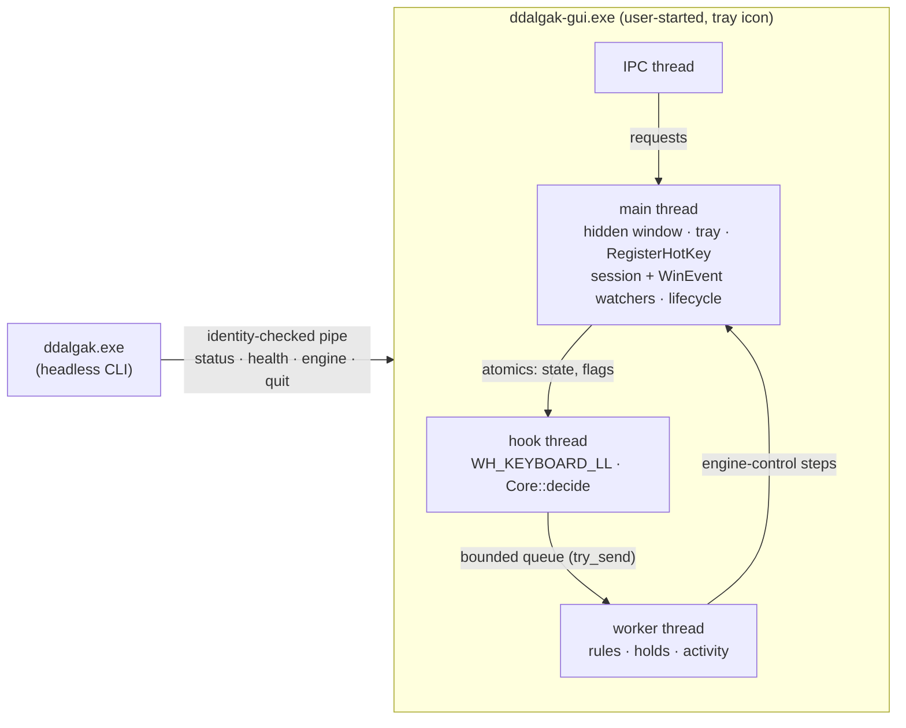

# Ddalgak engine (Step 66)

Status: **current** (implemented in Step 66 for Windows; remaps and the other actions follow in
Steps 68–72, the rule store in Step 67) · Decisions: [ADR 0022](adr/0022-ddalgak-rule-model-and-safety.md),
[ADR 0024](adr/0024-ddalgak-windows-input-apis-and-permissions.md) · Code: `crates/ddalgak` ·
Requirements: `DDALGAK-FR-001…004`, `DDALGAK-FR-008`, `DDALGAK-FR-017`, `DDALGAK-FR-060`,
`DDALGAK-NFR-001`, `DDALGAK-NFR-002`, `DDALGAK-NFR-004`, `DDALGAK-SEC-001…005`, `DDALGAK-SEC-007`,
`DDALGAK-SEC-010`, `DDALGAK-SEC-011`

This document describes what the Ddalgak engine does today, how it is built, how to drive it
from the CLI, what was measured and what was verified on real Windows. The *why* is in the ADRs;
the rule format is [DDALGAK_RULE_MODEL](DDALGAK_RULE_MODEL.md); the safety scope is
[DDALGAK_SAFETY](DDALGAK_SAFETY.md).

## 1. What Step 66 delivers, and what it does not

| Delivered | Not yet (owner Step) |
| --- | --- |
| `ddalgak-gui.exe`: the tray app that owns the engine (tray icon with state by shape and text, single instance per user session, hidden window, no editor) | the rule editor and playground windows (74, 76) |
| The low-level keyboard hook engine: event model, trigger tables, decision core, worker, lifecycle, emergency chord, held-key ledger, rate limit, stepping aside | remaps, send keys, text, launches, mouse, modes (68–72); mouse-button triggers and the mouse hook (68) |
| Ddalgak's own global shortcuts `engine.toggle` and `engine.pause` from `hotkeys.json`, registered with `RegisterHotKey` | the `ddalgak hotkeys …` commands (81; bind by editing `hotkeys.json` until then) |
| Rules: a read-only runtime view of `rules.json` that runs **engine-control rules** (`engine` steps) and keeps every other rule inactive with a stated code | the rule store, CRUD, full validation, history, live reload (67) |
| `ddalgak status`, `health`, `engine start|pause|resume|stop`, `pause`, `resume`, `quit`, `startup status|enable|disable`, `capabilities` with `--json` and `--dry-run` | `rule`, `profile`, `mode`, `test`, `explain` (67, 72, 76, 77, 81) |
| Opt-in start at sign-in through the user's Run key | — |

**Never broader.** A rule this version does not run is listed in `status` as inactive with its
code: `step_unsupported` (an action type of a later Step, or an unknown one),
`condition_unsupported` (`when`, Step 77), `rule_unsupported` (an unknown field inside the rule),
`trigger_invalid`/`trigger_reserved`, `duplicate_rule_id`, `duplicate_trigger`. A file that is
not a usable `ddalgak.rules` v1 document is not loaded at all and the engine cannot be turned on
with it (`rules_invalid`, `rules_from_newer_version`). `rules.json` is read again at every
`engine start`; it is never written by Step 66.

## 2. The event model

Each `KBDLLHOOKSTRUCT` becomes a `RawKey` and then a normalized `KeyEvent`
(`crates/ddalgak/src/event.rs`):

| Field | Meaning |
| --- | --- |
| `vk` | Virtual key; side-specific for modifiers (`VK_LSHIFT`, `VK_RCONTROL`, …; generic codes from injected input are resolved by scan code or the extended flag). Logical triggers (`J`, `F13`) match it; Windows assigns it per layout, so `Ctrl+Z` on QWERTZ is the key labeled Z. |
| `scan`, `extended` | The position. Physical triggers (`code:KeyZ`) match the scan code, whatever the layout. |
| `transition` | `Down`, `Repeat` (a down for a key that is already down) or `Up`. Holds are timed by the worker from the down. |
| `source` | `physical`, `injected_by_ddalgak` (`LLKHF_INJECTED` + the `dwExtraInfo` marker) or `injected_by_other_program`. |
| `device` | `unknown` for physical keys (the low-level hook does not identify keyboards), `synthetic` for injected ones. |
| `modifier`, `altgr_fake_ctrl` | Which of the eight modifier keys this is; the fake left Ctrl (scan `0x21D`) that precedes Right Alt on AltGr layouts. |

Modifier matching is exact (HOTKEY_CONTRACT §5.5): generic modifiers accept either side,
side-specific ones need that side, nothing else may be held, `Win` is never part of a trigger,
and AltGr is its own modifier (`AltGr+Q` ≠ `Ctrl+Alt+Q`). The normalizer keeps only the
current key state; nothing is recorded (`DDALGAK-SEC-001`).

**IME and layouts.** No character translation happens in the hook (dead keys stay intact).
While an IME window reports a composition (`EVENT_OBJECT_IME_SHOW`), no rule fires and keys pass
(`skipped_ime_composition`); IMEs that compose inline without an IME window may not report it,
which Steps 68–69 verify with the Korean IME. Layout switches change nothing in the rules.

## 3. The decision pipeline

`Core::decide` (`crates/ddalgak/src/core.rs`) runs inside the hook callback, allocation-free,
over a table compiled when the engine starts (`crates/ddalgak/src/table.rs`):

1. **Emergency chord** `Ctrl+Alt+Shift+Escape`, any order, on *physical* modifier state (AltGr's
   fake Ctrl counts as Ctrl). The event passes on, the engine state flips to off in the callback,
   the hook is removed right after it, held keys are released, the emergency marker is written
   and a tray notice explains it. Injected modifiers or an injected Escape never count.
2. **Own input** passes untouched and is never matched (two rules that point at each other are a
   swap, not a loop).
3. **Consumed down, consumed up**: a key-up and its auto-repeats are consumed exactly when the
   key-down was; a reload keeps the pairs.
4. **Candidates** in precedence order (mode-scoped first, then `priority`, then file order).
   Other programs' input only reaches `injected: accept` rules (`skipped_injected_input`
   otherwise). While paused only engine-control rules remain (`skipped_paused`).
5. **Stepping aside**: session locked or secure desktop (`skipped_secure_desktop`), a Win32
   password edit has focus (`skipped_password_field`), an IME composition
   (`skipped_ime_composition`), an elevated foreground window for injecting rules
   (`skipped_elevated_target`). The key passes unchanged.
6. **Triggers**: `press` (consumed unless `pass_through`), `release` (a tap with no other key in
   between; a bare modifier's down and up always pass so it keeps working in chords), `hold`
   (armed on down, fired by the worker after `hold_ms` unless released), `repeat: true`, and
   sequences of up to four chords (`Escape`, a non-matching step or a focus change cancel;
   pending steps are swallowed as the contract says).
7. **Rate limit** per rule (`max_runs_per_second`, default 20): runs beyond it are dropped with
   `rate_limited`, which stops storms of auto-repeat and loops through other programs.

Widened matching for `remap`/`block` (a trigger without modifiers matches with modifiers held,
except where that forms a reserved chord: with `Tab` remapped, `Alt+Tab` still switches
windows) is implemented and tested in the core for Step 68.

## 4. Process, threads and lifecycle



| State | Hook | How to get there |
| --- | --- | --- |
| `off` | none | app start (default), `ddalgak engine stop`, tray, `engine.toggle`, an engine-control rule (`disable`), the emergency chord, app exit |
| `running` | installed | `ddalgak engine start`, tray, `engine.toggle`, `engine_on_start: on` at a clean start; `resume` from paused |
| `paused` | installed (only engine-control rules run) | `ddalgak pause`, tray, `engine.pause`, a rule (`pause`, `toggle_pause`) |

- **Start policy** (`DDALGAK-FR-003`): off unless `engine_on_start: on`; always off, with a
  notice, after an unclean exit (the run marker `%LOCALAPPDATA%\mouv\ddalgak\engine.running` was
  left behind), after an emergency off (`engine.emergency`), with `--no-hotkeys`/`KIM_NO_HOTKEYS`,
  or when the app runs elevated. `status` reports the reason as `start.off_reason`.
- **No rule turns the engine on** (`DDALGAK-FR-004`); the lifecycle refuses it.
- **Held keys** are released on pause, stop, emergency, session lock or disconnect, shutdown,
  `Drop` and in the panic hook (`DDALGAK-SEC-005`).
- **Single instance** per user session (named mutex with the user SID in `Local\`, plus the
  pipe's first instance): a second `ddalgak-gui.exe` exits with `app_already_running` (7).
- **Sign-in start** (opt-in): `ddalgak startup enable` writes
  `HKCU\Software\Microsoft\Windows\CurrentVersion\Run\mouv.ddalgak` =
  `"<folder>\ddalgak-gui.exe" --startup`; `disable` removes it. No service, task or daemon.
- **Visibility**: the shipped app always shows its tray icon. The debug-only **test host**
  (`ddalgak-gui --test-host`, compiled out of release builds) has no tray icon, never consumes a
  key, and ends by itself; the automated tests use it.

## 5. Ddalgak's own shortcuts

`hotkeys.json` (`%APPDATA%\mouv\ddalgak\hotkeys.json`, hotkey contract v1) binds Ddalgak's GUI
actions; all ship unbound. Example:

```json
{ "schema": "kim.hotkeys", "schema_version": 1, "tool": "ddalgak",
  "overrides": [ { "action": "engine.toggle", "bindings": ["Ctrl+Alt+Shift+F9"] },
                 { "action": "engine.pause",  "bindings": ["Ctrl+Alt+Shift+F10"] } ] }
```

The app registers `engine.toggle` and `engine.pause` with `RegisterHotKey` at start, so they work
while the hook is off. `status` shows each as `registered`, `taken` (another program owns it;
nothing is retried or stolen), `unsupported` (left/right modifiers or `code:` keys, which
`RegisterHotKey` cannot express) or `unavailable` (`editor.open` before Step 74). An invalid file
is safe mode: nothing is registered.

## 6. CLI

`ddalgak --help` is the reference; every `--json` document is specified by
[ddalgak-cli-v1](contracts/schemas/ddalgak-cli-v1.schema.json) (examples from real runs in
`contracts/examples/ddalgak-cli-v1/`).

| Command | Effect | Notes |
| --- | --- | --- |
| `status` | read | Works without the app (then from the files, `engine.off_reason: app_not_running`). Activity names rule IDs and outcome codes only. |
| `health` | read | Needs the app. Hook installed/thread alive, callback timing, late events, dropped signals, panics, wake-ups, CPU time; `healthy` and `problems`. |
| `engine start` (`engine on`) | write, `--dry-run` | Re-reads `rules.json`. Refused: `rules_invalid` (4), `rules_from_newer_version` (5), `engine_elevated` (5), `hook_failed` (1). |
| `engine pause` / `pause` | write, `--dry-run` | `engine_off` (7) when off. |
| `engine resume` / `resume` | write, `--dry-run` | Never turns an engine on that is off. |
| `engine stop` (`engine off`) | write, `--dry-run` | Removes the hook. |
| `quit` | write, `--dry-run` | Ends the tray app (engine off first). |
| `startup status|enable|disable` | read / write, `--dry-run` | The user's Run value only. |
| `capabilities` | read | [tool-capabilities-v1](contracts/schemas/tool-capabilities-v1.schema.json) |

Every command that talks to the app first checks that the pipe is served by `ddalgak-gui.exe` of
the same user (`app_identity_mismatch`, 4) and sends nothing otherwise. Without the app it fails
with `engine_not_running` (3); the CLI never starts the app, installs a hook, opens a window or
shows a tray icon (`DDALGAK-FR-060`). Error codes: [CLI_CONTRACT §6](CLI_CONTRACT.md).

## 7. Measurements

Machine: Windows 10 Pro 19045, the maintainer's PC (shared, often locked during the run).
Numbers are local measurements (ADR 0012), never sent anywhere.

| What | Method | Result |
| --- | --- | --- |
| Decision cost, 1000 rules, key no rule uses (full scan) | `core::tests::decision_cost_with_1000_rules_…`, 20 000 calls | **0.28 µs** per event (release), 2.3 µs (debug) |
| Compiling 1000 rules into a table | same test | 31 µs (release), 155 µs (debug) |
| Installing the hook | `tests/hook_windows.rs` | 0.16–0.32 ms (debug) |
| `engine start` through the CLI (IPC round trip, rules load with 100 rules, hook install) | benchmark script below | 20 ms (debug) |
| **Idle, engine on, 100 rules, 60 s, no input** | debug test host; `ddalgak health` before and after; `GetProcessTimes` and Ddalgak's own wake-up counters | **CPU 0 ms** (below the 15.6 ms timer resolution, i.e. < 0.026 % of one core); hook-thread wake-ups **0**; worker wake-ups **0**; app main-thread wake-ups 1 (the second `health` request itself) |
| Idle, hook installed, 2 s, in-process | `tests/hook_windows.rs` | hook-thread wake-ups 0, worker wake-ups 0, CPU 0 µs |
| Hook callback time with real input | `tests/hook_windows.rs` (p99 bucket and maximum from the callback's own timing) | asserted p99 ≤ 1 ms when the desktop stays unlocked for the run (not observed yet, §8); the decision itself is the 0.28 µs above |

Method of the idle benchmark (reproducible): build the debug binaries, write a `rules.json` with
100 engine-control rules on `F13`–`F24` with modifier combinations into a sandbox `%APPDATA%`,
start `ddalgak-gui --test-host --endpoint <name>` with that environment, `ddalgak engine start`,
read `ddalgak health --json`, wait 60 s without input, read it again and subtract
`process.cpu_ms` and `counters.wakeups.*`. The engine has no timer: threads wake only for input,
posted messages and IPC requests. `DDALGAK-NFR-001` (< 0.1 % over 60 s with 100 rules) is met by
this run; the release tray app is measured in Step 82 (its tray icon cannot be shown on the
maintainer's desktop during automated runs).

## 8. Verification status on real Windows

| Check | Status | Evidence |
| --- | --- | --- |
| Hook installs, observes, unhooks on stop, on the watchdog timeout and while unwinding a panic | **tested** (Windows 10 19045) | `tests/hook_windows.rs` |
| No idle wake-ups or CPU with the hook installed | **tested** | §7 |
| Own injected input is never matched | **tested** with real `SendInput` (40 marked events, all seen as Ddalgak's own, none fired a rule that accepts injected input) | `tests/hook_windows.rs` |
| Other programs' injected input reaches only `injected: accept` rules | **tested** through the real app (below) | `tests/cli.rs` |
| Held keys released by `release_all` and on drop (checked with `GetAsyncKeyState`), a 40-event storm through "another program" cut by the rate limit, p99 callback time with real input | **attempted, not observed**: the shared workstation locked during each run, so the test reported `skipped (SendInput refused)`; the logic is unit-tested (`inject`, `core`). Re-run `cargo test -p ddalgak --test hook_windows -- --nocapture` on an unlocked desktop | `tests/hook_windows.rs` |
| The real app: an injected `F13` fires an engine-control rule (paused), it works while paused (resumed), `F14` turns the engine off and the hook is removed | **tested** (one unlocked run on this machine) | `tests/cli.rs::injected_input_reaches_only_accepting_rules_in_the_real_app`, example `status-paused-by-rule.json` |
| `RegisterHotKey` registration of `engine.toggle`/`engine.pause` (`Ctrl+Alt+Shift+F13/F14`) in the running app | **tested** (`registered`) | `tests/cli.rs::the_app_lifecycle_through_the_cli` |
| **Pressing** a registered shortcut toggles the engine with no window open | **not tested**: pressing it needs `Alt` held, and tests may inject only F13–F20 on this shared machine | manual steps below |
| Emergency chord with physical keys | **not tested** (must not be injected; physical keys only): core unit tests cover it; real-keyboard check below and in Step 73 | manual steps below |
| Tray icon and menu | **not tested** (would show on the maintainer's desktop); icons are built in a test without showing | manual steps below |
| Password edit detection | **tested** on a hidden Win32 edit with `ES_PASSWORD` (not focused); focus-driven behavior **not tested** | `win::context` tests |
| IME composition guard with the Korean IME, elevated-window skipping | **not tested** (no Korean IME test setup; no injecting rule exists yet) | Steps 68–70 |
| Session lock releases keys and stops rules | **not tested** (needs a lock/unlock during a run) | Step 73 |
| Single instance, start policy markers, invalid rules, pipe squatter, private Run key | **tested** | `tests/cli.rs` |
| Elevated app refuses to turn the engine on | implemented; the tests take an elevated branch that asserts `engine_elevated` when they run as administrator (as on CI runners); **not run elevated on this machine** (no elevation, AGENTS.md §5) | `tests/cli.rs` |

**Manual check for the maintainer** (about five minutes; uses the release build and shows the
tray icon on your desktop):

1. `cargo build -p ddalgak --release`.
2. Create `%APPDATA%\mouv\ddalgak\hotkeys.json` with the example of §5 (`Ctrl+Alt+Shift+F9`
   toggles, `Ctrl+Alt+Shift+F10` pauses).
3. Start `target\release\ddalgak-gui.exe`. A ring icon appears in the notification area; its
   tooltip says "Ddalgak: engine off". No window opens.
4. Press `Ctrl+Alt+Shift+F9`. The icon becomes a filled disc ("engine on");
   `target\release\ddalgak status` shows `engine: running` and the last change
   `shortcut:engine.toggle`. Type in any program: nothing changes (no rule consumes keys).
5. Press `Ctrl+Alt+Shift+F10`: two bars ("paused"); again: the disc.
6. Press `Ctrl+Alt+Shift+Escape`. The icon becomes the ring and a notice says the emergency
   chord turned the engine off; `ddalgak status` shows `off (emergency)` after the next start.
7. Right-click the icon: the menu turns the engine on and off and quits. Quit, start the app
   again: the engine stays off and a notice names the emergency.
8. `target\release\ddalgak startup enable`, sign out and in: the tray icon is back, engine off;
   `ddalgak startup disable` removes the Run value.

## 9. Files

| Path | What |
| --- | --- |
| `crates/ddalgak/src/{event,trigger,table,core,worker,lifecycle,inject,shortcuts,rules,ipc,startup,stats}.rs` | portable engine, unit-tested on every platform |
| `crates/ddalgak/src/win/{hook,inject,context,host,tray,pipe,instance,startup}.rs` | Windows layer |
| `crates/ddalgak/src/main.rs`, `cli.rs`, `output.rs` | the `ddalgak` CLI |
| `crates/ddalgak/src/bin/ddalgak-gui.rs` | the tray app |
| `crates/ddalgak/hotkeys.manifest.json` | the built-in hotkey manifest (equal to the contract example) |
| `crates/ddalgak/tests/{cli,hook_windows}.rs` | real-binary and real-hook tests |
| `e2e/tests/step66_ddalgak_engine.rs` | the e2e scenario (runs only through `cargo xtask e2e`) |
