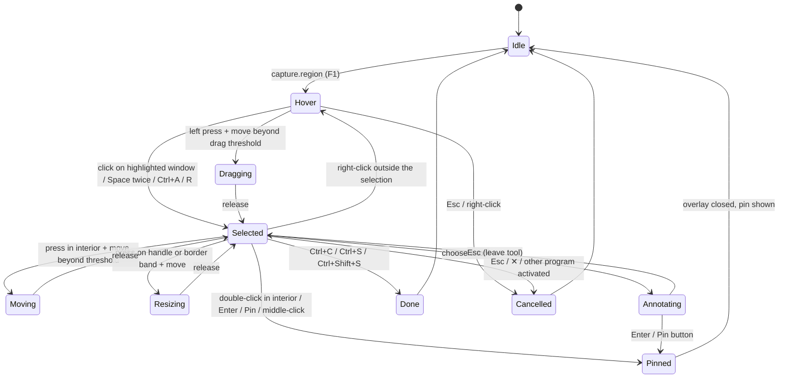

# Noeul UX specification

Status: **current** (specification; Step 49 implemented the app foundation, [ADR 0023](adr/0023-noeul-app-foundation.md), not the overlay) · Step 48 ·
Philosophy: [NOEUL_PHILOSOPHY](NOEUL_PHILOSOPHY.md) · Requirements: [NOEUL_REQUIREMENTS](NOEUL_REQUIREMENTS.md) ·
Parity: [NOEUL_SNIPASTE_MATRIX](NOEUL_SNIPASTE_MATRIX.md) · Shortcuts: [HOTKEY_CONTRACT §13.3](HOTKEY_CONTRACT.md) ·
Decision: [ADR 0021](adr/0021-noeul-product-definition.md)

This document says what the user sees and does: journeys and click paths, wireframes, the
exact rules of the double-click-to-pin flow and its tests, the default keys, and how Noeul
behaves where a desktop is not available. The wireframes are original sketches for Noeul; they
show layout and order, not final pixels (those follow [DESIGN_SYSTEM](DESIGN_SYSTEM.md)).

## 1. Words

| Word | Meaning |
| --- | --- |
| **Overlay** | The full-desktop window shown after `F1`: the frozen picture, dimmed outside the selection |
| **Frozen picture** | The image of every monitor taken when the capture started. Everything is cut from it, never from the live screen. |
| **Selection** | The rectangle the user is choosing. It is **confirmed** once the button is released after a drag, a detected window is clicked, the second corner is marked by keyboard, or `Ctrl+A`, `R` or a history step set it. |
| **Interior** | The confirmed selection minus its handle zones and border band, and minus any part covered by the toolbar |
| **Handle zone** | Eight squares of 9×9 logical pixels centered on the corners and the edge midpoints of the selection |
| **Border band** | 3 logical pixels on each side of the selection's edges, used to resize by an edge |
| **Toolbar** | The floating bar of buttons next to the confirmed selection |
| **Pin** | A floating, always-on-top window showing an image or a card |
| **Card** | A pin made from text, HTML or a color value |
| **System values** | The user's Windows settings: double-click time (`GetDoubleClickTime`), double-click rectangle (`SM_CXDOUBLECLK` × `SM_CYDOUBLECLK`) and drag threshold (`SM_CXDRAG` × `SM_CYDRAG`); Windows defaults are 500 ms, 4×4 and 4×4 pixels (*documented*) |

When a selection is smaller than three handle zones in either direction (27 logical pixels),
the handles and the border band move outside the rectangle, so its whole area is interior.

## 2. User journeys and click paths

Each journey has a mouse path and a keyboard-only path; both reach the same result.

| # | Journey | Mouse path | Keyboard-only path | Result | Requirements |
| --- | --- | --- | --- | --- | --- |
| J1 | **Capture and pin** (the signature flow) | `F1` → drag a rectangle → double-click inside it | `F1` → `W A S D` to the first corner → `Space` → to the opposite corner → `Space` → `Enter` | A pin of exactly that rectangle at the same place; overlay gone; clipboard untouched | NOEUL-FR-020…022, NOEUL-FR-043 |
| J2 | Capture a window and pin it | `F1` → hover the window (it is highlighted) → click → double-click inside | `F1` → move the pointer over it → `Space` → `Enter` | Pin of the window's rectangle | NOEUL-FR-040 |
| J3 | Copy a region | `F1` → drag → toolbar **Copy** (or right-click → Copy) | `F1` → select → `Ctrl+C` | Image on the clipboard (PNG and bitmap); overlay gone; no pin | NOEUL-FR-023, NOEUL-FR-030 |
| J4 | Save a region | `F1` → drag → **Save** (`Shift`+click: quick save) | `Ctrl+S` (dialog) or `Ctrl+Shift+S` (quick save) | A PNG file; no pin, clipboard untouched | NOEUL-FR-023, NOEUL-FR-031, NOEUL-FR-032 |
| J5 | Mark up, then pin | `F1` → drag → pick a tool on the toolbar → draw → `Esc` (leave the tool) → double-click inside | … → `Tab` to the tool → `Enter` → draw with the pointer keys → `Enter` (pins with the drawing) | A pin carrying editable annotations | NOEUL-FR-080, NOEUL-FR-081 |
| J6 | Pin the clipboard | Tray middle-click, or tray menu → Pin clipboard | `F3` | A pin (image) or a card (text, HTML, color) at the pointer | NOEUL-FR-070, NOEUL-FR-071 |
| J7 | Work with a pin | Drag to move, wheel to zoom, `Ctrl`+wheel for opacity, middle-click to reset, right-click for the menu | Click or create it (it has focus) → arrows, `Plus`/`Minus`, `0`, `1`–`4`, `Shift+F10` for the menu | Moved, zoomed, rotated, flipped pin | NOEUL-FR-061, NOEUL-FR-062 |
| J8 | Close and reopen | `Esc` or menu → Close; tray → Reopen closed pin | `Esc` / `Ctrl+W`; `noeul pin reopen` | The pin comes back with its transform | NOEUL-FR-065 |
| J9 | Look through a pin (click-through) and back | Menu → Click-through; tray → Make all pins clickable | `Ctrl+Shift+T` on the pin; start `noeul` again → settings → Pins | Pin ignores the mouse, shows a marker; recovered on demand | NOEUL-FR-063, NOEUL-SEC-013 |
| J10 | Change a shortcut or the gesture | Tray → Settings → Shortcuts → row → Change → press keys; Gestures → Double-click inside a selection: Pin / Copy / Save / Nothing | `noeul hotkeys set capture.region Shift+F1`; settings by keyboard | New binding active at once; conflicts reported | NOEUL-FR-024, NOEUL-FR-100, NOEUL-FR-101 |
| J11 | Without the tray icon | — | Hotkeys work; start `noeul` again to open settings; `noeul status --json` | Everything reachable | NOEUL-FR-004 |
| J12 | A script or agent captures | — | `noeul capture --region 0,0,800,600 --output shot.png --json` | A file and a JSON result; a visible notice; no window | NOEUL-FR-112, NOEUL-SEC-010 |

## 3. Wireframes

### 3.1 Overlay with a confirmed selection and the floating toolbar

```text
+--------------------------------------------------------------------------+
|//////////////////////////// dimmed frozen picture ///////////////////////|
|///////  [ 640 × 360  at 412, 188 ]  <- size chip (device pixels) ////////|
|///////  o-----------------o-----------------o  ///////////////////////////|
|///////  |                                   |  ///////////////////////////|
|///////  |                                   |  //////  +-------------+  //|
|///////  o     selection (not dimmed)        o  //////  | magnifier   |  //|
|///////  |     double-click here = PIN       |  //////  |   [ + ]     |  //|
|///////  |                                   |  //////  | 412, 188    |  //|
|///////  o-----------------o-----------------o  //////  | #3A6EA5     |  //|
|///////  +--------------------------------------------+ +-------------+  //|
|///////  | [Pin] | Copy  Save | ▭ ◯ ／ → ✎ ▮ T ▦ ◌ ⌫ | ↶ ↷ |  ✕  | /////////|
|///////  +--------------------------------------------+ //////////////////|
|//////////////////////////////////////////////////////////////////////////|
+--------------------------------------------------------------------------+
  o = resize handle   [Pin] = primary button (accent fill, first in tab order)
  ▭ ◯ ／ → ✎ ▮ T ▦ ◌ ⌫ = rectangle, ellipse, line, arrow, pen, marker, text,
  mosaic, blur, eraser (N3)   ↶ ↷ = undo, redo   ✕ = cancel (Esc)
```

- The toolbar sits below the selection, or above it when there is no room, or inside its
  bottom edge when the selection fills the monitor. It never covers the size chip.
- Tooltips name the action, its keys and its gesture: "Pin — double-click inside or Enter",
  "Copy — Ctrl+C", "Save — Ctrl+S (Shift: quick save)".
- First run only: a one-line hint above the toolbar, "Double-click inside to pin it. Ctrl+C
  copies, Ctrl+S saves." It disappears after the first pin, copy or save and can be turned off.

### 3.2 Selection context menu (right-click inside, or `Shift+F10`)

```text
+-------------------------------+
| Pin              Enter        |
| Copy             Ctrl+C       |
| Save…            Ctrl+S       |
| Quick save       Ctrl+Shift+S |
|-------------------------------|
| Select monitor   Ctrl+A       |
| Last rectangle   R            |
|-------------------------------|
| Cancel           Esc          |
+-------------------------------+
```

### 3.3 A pin and its menu

```text
   +--------------------------+         +----------------------------------+
   |                          |         | Copy                 Ctrl+C      |
   |   pinned image (100 %)   |  right  | Save…                Ctrl+S      |
   |                     [⇣]  |  click  | Copy text            Ctrl+Shift+C|  (cards)
   |                          |  ---->  |----------------------------------|
   +--------------------------+         | Zoom 100 %           0           |
     1 px subtle border, soft shadow    | Rotate right / left  1 / 2       |
     [⇣] = click-through marker         | Flip                 3 / 4       |
           (only in that mode)          | Opacity ▸  100 90 75 50 25 %     |
                                        | Thumbnail            T           |
                                        | Click-through        Ctrl+Shift+T|
                                        | Annotate             Space       |
                                        | Group ▸                          |
                                        |----------------------------------|
                                        | Hide                 H           |
                                        | Close                Esc         |
                                        | Destroy              Shift+Esc   |
                                        +----------------------------------+
```

### 3.4 Tray menu (optional tray icon)

```text
+-----------------------------------+
| Capture region            F1      |
| Pin clipboard             F3      |
|-----------------------------------|
| Show all pins / Hide all pins     |
| Make all pins clickable           |
| Bring pins on screen              |
| Reopen closed pin                 |
| Groups ▸                          |
|-----------------------------------|
| Keyboard shortcuts: On            |
| Settings…                Ctrl+,   |
| Quit Noeul                        |
+-----------------------------------+
```

### 3.5 Settings: Gestures and Shortcuts

```text
+- Noeul settings ---------------------------------------------------------+
| General      | Gestures                                                  |
| Capture      |                                                           |
| Gestures   < |  Double-click inside a selection   ( Pin  v )             |
| Pins         |  Middle-click inside a selection   ( Pin  v )             |
| History      |  Double-click on a pin             ( Nothing  v )         |
| Privacy      |  [ ] Snipaste-style gestures (double-click and Enter copy, |
| Shortcuts    |      Ctrl+T and middle-click pin)                         |
| About        |  Uses your Windows double-click speed: 500 ms  [Windows…]  |
|              |                                     [Reset this section]  |
+--------------+-----------------------------------------------------------+

+- Shortcuts --------------------------------------------------------------+
|  Keyboard shortcuts: [On]                             [Reset all…]       |
|  Action                     Keys            Scope            State       |
|  Capture a region           F1              global           default     |
|  Pin the clipboard          F3              global           taken ⚠     |
|    ⚠ Another program uses F3. Try Shift+F3.  [Change] [Disable] [Keep]  |
|  Pin the selection          Enter           capture overlay  default     |
|  (gesture) Double-click     inside selection capture overlay  Pin        |
|  …                                                                       |
|  Row: [Change] [Disable] [Reset]                                         |
+--------------------------------------------------------------------------+
```

### 3.6 Notices

Small non-modal toasts near the pointer's monitor corner, 2 s, never stealing focus, announced to
screen readers: "Pinned", "Copied", "Saved to Pictures\Noeul", "Nothing to pin", "F3 is used by
another program". A capture requested by the CLI or an agent shows "Noeul captured a region
(command line)" (NOEUL-SEC-010).

## 4. The signature flow: precise rules

### 4.1 States



### 4.2 Rules

1. **Only a confirmed selection can be pinned.** In `Hover` and `Dragging` there is nothing to
   pin, so no gesture pins.
2. **What a double-click is.** Two left-button presses P1 and P2 such that: both are in the
   interior; P2 comes within the system double-click time after P1 and inside the system
   double-click rectangle centered on P1; the pointer did not move beyond the drag threshold
   while P1 was held; no modifier key (`Ctrl`, `Alt`, `Shift`, `Win`) is down at P1 or P2; the
   state is `Selected` (not `Annotating`). Noeul counts presses itself from raw button events with
   the system values; it does not rely on the window class's double-click messages.
3. **The pin fires on P2's press**, not on its release, so it appears immediately. The release of
   P2 and any pointer movement until that release are ignored by the new pin; it cannot be
   dragged by the tail of the gesture.
4. **Presses that do something else never start a double-click.** A press that became a drag,
   move or resize (moved beyond the threshold while held) is not P1. The release that ends a
   drag is not a click. A press on a handle, the border band, the toolbar, the size chip or the
   magnifier is not P1 or P2.
5. **Outside means nothing.** A double-click outside the selection, or with one press inside
   and one outside, pins nothing and leaves the selection as it is. A drag outside the confirmed
   selection starts a new selection that replaces it.
6. **Annotation first.** While a tool is active, presses draw (a double-click may end a polyline
   or select a word in a text label). `Esc` leaves the tool; then the double-click pins again.
   `Enter` and the Pin button always pin, with the annotations.
7. **Keyboard focus rule.** `Enter` pins while the selection (the canvas) has keyboard focus.
   When a toolbar button, a menu or a text field has focus, the reserved navigation keys
   (`Enter`, `Space`, `Tab`, `Esc`, arrows) go to that control first, so `Enter` on **Copy**
   copies. This is how Noeul applies HOTKEY_CONTRACT §7.2 ("a context may bind navigation keys")
   without breaking keyboard navigation (ADR 0021).
8. **The pin.** Its top-left corner is the selection's top-left in device pixels, its size is
   the selection's size in device pixels, zoom 100 %, opacity 100 %, in the current group; it
   shows the frozen picture's pixels (and annotations as editable layers). The overlay closes and
   the new pin has keyboard focus, so `Esc`, arrows and `0` work at once; "Pinned" is announced.
9. **No side effects.** Pinning opens neither the clipboard nor any file. The clipboard
   sequence number is unchanged and no file appears (NOEUL-SEC-005).
10. **The new pin ignores the rest of the gesture.** For one system double-click time after it
    appears, a pin ignores presses, so a triple or quadruple click yields one untouched pin. A
    double-click on a pin has no default action at any time (NOEUL-FR-026).
11. **Failure keeps the work.** If the pin cannot be created, the overlay stays in `Selected`
    with an error banner; copy and save still work (NOEUL-FR-025).
12. **Other paths.** Middle-click in the interior pins (setting: Pin, Copy, Nothing). The
    gesture setting (NOEUL-FR-024) changes only what the double-click does; `capture.pin` keeps
    its own keys. The Snipaste-style preset changes both and is shown by name.
13. **Settings follow Windows.** When the user changes the double-click speed or drag
    threshold, Noeul uses the new values from the next press (`WM_SETTINGCHANGE`), without a
    restart.

### 4.3 Test specification

Each case is written so that it can be automated (§4.4). `T` = system double-click time, `D` =
system double-click rectangle, `H` = drag threshold; tests inject these values.

| Case | Given | When | Then | Requirements |
| --- | --- | --- | --- | --- |
| FLOW-01 | Overlay on one 100 % monitor, confirmed selection (100,100)–(500,400) | Two left presses at (300,250), 120 ms apart, no movement | One pin at (100,100), 400×300, 100 %, the frozen pixels; overlay closed; clipboard sequence unchanged; no file written | NOEUL-FR-020, NOEUL-SEC-005 |
| FLOW-02 | As FLOW-01 | P2 at T − 1 ms | Pin | NOEUL-FR-021 |
| FLOW-03 | As FLOW-01 | P2 at T + 1 ms | No pin; selection unchanged; overlay open | NOEUL-FR-021 |
| FLOW-04 | As FLOW-01 | P2 offset inside D / outside D | Pin / no pin | NOEUL-FR-021 |
| FLOW-05 | As FLOW-01 | Both presses outside the selection | No pin; selection unchanged | NOEUL-FR-021 |
| FLOW-06 | As FLOW-01 | P1 inside, P2 outside (and the reverse) | No pin | NOEUL-FR-021 |
| FLOW-07 | As FLOW-01 | Double-click on a corner handle; on the border band; on the size chip | No pin | NOEUL-FR-021 |
| FLOW-08 | As FLOW-01 | Double-click on the toolbar's Copy button | Copy runs once (overlay closes); no pin | NOEUL-FR-021, NOEUL-FR-023 |
| FLOW-09 | As FLOW-01 | Press in interior, move 20 px, release (a move); then two quick presses | The move does not count; the two later presses pin the moved rectangle | NOEUL-FR-021 |
| FLOW-10 | As FLOW-01 | P1, move by less than H, release, P2 | Pin; the selection did not move | NOEUL-FR-021 |
| FLOW-11 | As FLOW-01 | Resize by dragging the right handle, release, then double-click in interior | Pin of the resized rectangle | NOEUL-FR-012, NOEUL-FR-021 |
| FLOW-12 | Overlay in `Hover` | Drag a selection ending at (x,y), release, one press at (x,y) within T | No pin (the drag's press is not P1) | NOEUL-FR-021 |
| FLOW-13 | Pen tool active | Double-click inside; then `Enter` | First: drawing only, no pin; then a pin carrying the stroke | NOEUL-FR-021, NOEUL-FR-080 |
| FLOW-14 | Editing a text label | Double-click on a word | Word selected; no pin | NOEUL-FR-021 |
| FLOW-15 | Pen tool active | `Esc`, then double-click inside | Tool left, drawing kept; pin | NOEUL-FR-081 |
| FLOW-16 | Confirmed selection, canvas focused | `Enter` | Same result as FLOW-01 | NOEUL-FR-022 |
| FLOW-17 | Confirmed selection | `Tab` to Copy, `Enter`; again with `Tab` to Pin, `Enter` | Copy (no pin); then pin | NOEUL-FR-022, NOEUL-FR-023 |
| FLOW-18 | Overlay, keyboard only | `W A S D` to (100,100), `Space`, to (500,400), `Space`, `Enter` | Pin of (100,100)–(500,400) | NOEUL-FR-043, NOEUL-NFR-012 |
| FLOW-19 | Confirmed selection | `Ctrl+C` | Clipboard holds PNG and `CF_DIBV5` with the frozen pixels; no pin; overlay closed | NOEUL-FR-023, NOEUL-FR-030 |
| FLOW-20 | Confirmed selection | `Ctrl+Shift+S` | One new PNG in the quick-save folder with the frozen pixels; no pin; clipboard unchanged | NOEUL-FR-023, NOEUL-FR-032 |
| FLOW-21 | As FLOW-01 | Middle-click inside; middle-click outside | Pin; nothing | NOEUL-FR-022 |
| FLOW-22 | As FLOW-01 | Double-click with `Ctrl`, `Shift` or `Alt` held | No pin | NOEUL-FR-021 |
| FLOW-23 | As FLOW-01 | Right-button double-click inside | Menu opens; no pin | NOEUL-FR-021 |
| FLOW-24 | Gesture setting `copy` | Double-click inside | Copy, no pin; `Enter` still pins | NOEUL-FR-024 |
| FLOW-25 | Gesture setting `none` | Double-click inside | Nothing | NOEUL-FR-024 |
| FLOW-26 | Pin creation made to fail | Double-click inside | Overlay stays, error shown, selection intact; `Ctrl+C` still copies | NOEUL-FR-025 |
| FLOW-27 | Another process keeps the clipboard open | Double-click inside | Pin created normally | NOEUL-FR-025 |
| FLOW-28 | As FLOW-01 | Triple and quadruple click | Exactly one pin, not moved, not closed | NOEUL-FR-026 |
| FLOW-29 | Idle | Ten times: `F1`, select, double-click, as fast as possible | Ten pins with distinct IDs; none lost; one overlay at a time | NOEUL-FR-013, NOEUL-FR-060 |
| FLOW-30 | Overlay open | `F1` again, then double-click inside | Still one overlay; one pin | NOEUL-FR-013 |
| FLOW-31 | Two side-by-side monitors at the same scale | Selection across the seam; double-click | One pin across both monitors with exact pixels | NOEUL-FR-090 |
| FLOW-32 | One monitor at 150 % | Select 600×450 device pixels; double-click | Pin is 600×450 device pixels; readout said 600 × 450 | NOEUL-FR-090 |
| FLOW-33 | Monitors at 100 % and 150 % (N4) | Pin on one, drag it to the other | Pixel size unchanged | NOEUL-FR-091 |
| FLOW-34 | A text editor had focus before `F1` | Pin, then `Esc` | Pin focused after creation; `Esc` closes it; the editor received no input | NOEUL-FR-060, NOEUL-SEC-012 |
| FLOW-35 | Session locked | `F1`; `noeul capture --region 0,0,10,10 --output x.png` | No overlay; the command fails with `desktop_unavailable` and writes nothing | NOEUL-SEC-003 |
| FLOW-36 | Windows double-click time changed to 900 ms while Noeul runs | Presses 800 ms apart | Pin | NOEUL-NFR-012 |
| FLOW-37 | Selection of 10×10 pixels | Double-click on it | Pin (the whole rectangle is interior) | NOEUL-FR-021 |
| FLOW-38 | Selection filling the monitor, toolbar inside it | Double-click on the toolbar; elsewhere inside | No pin; pin | NOEUL-FR-021 |

### 4.4 How later Steps automate this

| Layer | Step | What runs | Covers | Rules |
| --- | --- | --- | --- | --- |
| Gesture unit tests | 51 | A platform-independent gesture module fed with sequences of (time, position, button, press/release/move, modifiers), selection and hit-zone geometry, tool state and the system values; it returns commands (pin, copy, move, resize, …). Table-driven, part of `cargo test`. | FLOW-02…15, 21–25, 28, 36–38 | No window, no OS input |
| Window integration tests | 51, 53 | A real overlay and real pin windows on a test-supplied frozen picture, positioned off-screen (for example at −6000,−6000), never activated, no taskbar entry; events posted to Noeul's own windows only; assertions on pin windows, the clipboard sequence number and the file system | FLOW-01, 16–20, 26, 27, 29–32, 34 | Headless rules of the brief: nothing visible on the maintainer's screen, no `SendInput` |
| e2e scenario | 51 (`e2e/tests/step51_double_click_pin.rs`) | The real `noeul` binary built with a test-only feature that accepts synthetic pointer events over its IPC (absent from release builds); `noeul pin list --json` and `noeul status --json` check the result | FLOW-01, 16, 19, 28, 29, 35 | Runs only through `cargo xtask e2e` (AGENTS.md §4) |
| Manual script | 51, then 63 | The real-Windows script below, with a physical mouse and keyboard | Everything that needs real input, DPI and focus | Windows build, scales and date recorded in the Step report and the matrix Evidence column |

**Real-Windows script** (Windows 10 19045 and Windows 11; 100 % and 150 %; two monitors where
available):

1. Copy some text in Notepad. Start Noeul. `F1`, drag around part of the Notepad window,
   double-click inside: a pin appears at once, at the same place and size. Paste in Notepad: the
   earlier text comes out (the clipboard was not touched).
2. Click into Notepad and type: the pin stays on top and Notepad gets the keys.
3. `F1`, select, `Enter`: a pin. `F1`, select, `Ctrl+C`, paste into Paint: same pixels, no pin.
4. `F1`, select, double-click outside, then on a handle: nothing is pinned.
5. `F1`, select, quadruple-click inside: exactly one pin, still there.
6. Set the Windows double-click speed to the slowest setting; repeat step 1 with slow clicks.
7. On a 150 % monitor, save a pinned 600×450 selection and check the file is 600×450 pixels.
8. Lock the session (`Win+L`), press `F1`, unlock: no overlay appeared; no capture was taken.
9. Ten captures in a row as fast as possible: ten pins.
10. Measure capture and pin latency with Noeul's debug metric and record them (NOEUL-NFR-003,
    NOEUL-NFR-004).

## 5. Toolbar, menus and the tray

- **Toolbar order** (tab order): Pin · Copy · Save · tools (N3) · Undo · Redo · Cancel. Pin is the
  only accent-filled button. Every button has a text tooltip with its keys; icons are original
  Noeul artwork.
- **Keyboard:** `Tab`/`Shift+Tab` move between the canvas and the toolbar buttons, `F6` moves
  between the canvas, the toolbar and the magnifier readout, `Shift+F10` opens the context menu
  of the focused element. Arrow keys move the selection while the canvas has focus and move
  between buttons while the toolbar has focus.
- **Tray icon:** optional. Left-click captures, middle-click pins the clipboard, right-click
  opens the menu (§3.4), double-click opens settings. Its tooltip reads "Noeul — 3 pins".

## 6. Default shortcuts and gestures

The final hotkey manifest is
[`kim-hotkey-manifest-v1/noeul.json`](contracts/examples/kim-hotkey-manifest-v1/noeul.json)
(backend `register`). It is the target for the first release; each Step ships the subset it
implements (NOEUL-FR-114) under exactly these IDs and defaults. Every binding can be changed,
disabled and reset (HOTKEY_CONTRACT §8–§12).

**Global and app actions** (also summarized in the Kim catalog):

| Action | Default | Scope | What it does |
| --- | --- | --- | --- |
| `capture.region` | `F1` | global (or app) | Start a region capture |
| `paste.float` | `F3` | global (or app) | Pin the clipboard |
| `settings.open` | `Ctrl+Comma` | app | Open settings |

Planned global actions without defaults (show or hide all pins, make all pins clickable, reopen
the last closed pin, capture the active window) are added to the manifest in the Steps that
implement them, together with the catalog's shortcut summary (NOEUL-FR-005). No other global
default will be added (HOTKEY_CONTRACT §7.5).

**Context `capture-overlay`** (while the overlay has focus):

| Action | Default | Action | Default |
| --- | --- | --- | --- |
| `capture.pin` | `Enter` | `selection.move-up`/`-down`/`-left`/`-right` | arrows (repeat) |
| `capture.copy` | `Ctrl+C` | `selection.grow-up`/`-down`/`-left`/`-right` | `Ctrl`+arrows (repeat) |
| `capture.save` | `Ctrl+S` | `selection.shrink-up`/`-down`/`-left`/`-right` | `Shift`+arrows (repeat) |
| `capture.quick-save` | `Ctrl+Shift+S` | `pointer.move-up`/`-down`/`-left`/`-right` | `code:KeyW`/`code:KeyS`/`code:KeyA`/`code:KeyD` (repeat) |
| `capture.cancel` | `Escape` | `detect.cycle` | `E` |
| `selection.mark` | `Space` | `magnifier.toggle` | `M` |
| `selection.full` | `Ctrl+A` | `color.copy` | `C` |
| `selection.last` | `R` | `color.format-next` | `Shift+C` |
| `history.previous` | `Comma` | `history.next` | `Period` |

**Context `annotate`** (while a drawing tool is active, in the overlay or on a pin; it is inside
the other contexts, so its keys win there):

| Action | Default |
| --- | --- |
| `annotate.done` | `Escape` (leave the tool, keep the drawing) |
| `annotate.undo` | `Ctrl+Z` |
| `annotate.redo` | `Ctrl+Y`, `Ctrl+Shift+Z` |
| `annotate.width-down` / `annotate.width-up` | `char:[` / `char:]` (repeat) |
| `annotate.rectangle`, `.ellipse`, `.line`, `.arrow`, `.pen`, `.marker`, `.text`, `.mosaic`, `.blur`, `.eraser`, `.redact`, `.clear-all` | none (bindable) |

**Context `pin`** (while a pin has focus):

| Action | Default | Action | Default |
| --- | --- | --- | --- |
| `pin.close` | `Escape`, `Ctrl+W` | `pin.rotate-cw` / `pin.rotate-ccw` | `1` / `2` |
| `pin.destroy` | `Shift+Escape` | `pin.flip-horizontal` / `pin.flip-vertical` | `3` / `4` |
| `pin.copy` | `Ctrl+C` | `pin.zoom-in` / `pin.zoom-out` | `Plus`, `NumpadAdd` / `Minus`, `NumpadSubtract` |
| `pin.save` | `Ctrl+S` | `pin.zoom-reset` | `0`, `Numpad0` |
| `pin.quick-save` | `Ctrl+Shift+S` | `pin.opacity-up` / `pin.opacity-down` | `Ctrl+Plus` / `Ctrl+Minus` |
| `pin.copy-text` | `Ctrl+Shift+C` | `pin.move-up`/`-down`/`-left`/`-right` | arrows (repeat) |
| `pin.thumbnail` | `T` | `pin.click-through` | `Ctrl+Shift+T` |
| `pin.hide` | `H` | `pin.annotate` | `Space` |

**Choices and where they differ from Snipaste** (the matrix lists each):

- `Enter` pins (Snipaste: copies). `Ctrl+T` is free; the Snipaste-style preset binds it.
- `Tab` stays keyboard navigation; detection cycles with `E` (Snipaste: `Tab`).
- The contract has no bare-modifier keys, so the magnifier toggles with `M` (Snipaste: hold
  `Alt`) and the color format switches with `Shift+C` (Snipaste: `Shift`).
- `W A S D` are physical keys (`code:`), so they keep their position on AZERTY and other
  layouts.
- `Ctrl+Shift+Z` is redo; "clear all" is an ordinary undoable command (Snipaste: `Ctrl+Shift+Z`
  removes all edits without undo).
- No `F` keys are used inside contexts, so the global `F1`/`F3` and their remap offers
  (`Shift+F1`, `Shift+F3`, …) never collide with Noeul's own bindings.

**Mouse gestures** (configured in settings, listed with the shortcuts, HOTKEY_CONTRACT §11.1):

| Where | Gesture | Default | Keyboard alternative |
| --- | --- | --- | --- |
| Inside a confirmed selection | Double-click | **Pin** (setting: Pin, Copy, Save, Nothing) | `Enter` |
| Inside a confirmed selection | Middle-click | Pin (setting) | `Enter` |
| Selection | Right-click | Context menu (inside), clear (outside), cancel (no selection) | `Shift+F10`, `Esc` |
| Pin | Drag / wheel / `Ctrl`+wheel | Move / zoom / opacity | arrows / `Plus` `Minus` / `Ctrl+Plus` `Ctrl+Minus` |
| Pin | Middle-click | Reset to 100 % and opaque | `0` |
| Pin | Double-click | **Nothing** (setting: Nothing, Close, Thumbnail, Reset) | — |
| Pin | Shift+double-click | Thumbnail | `T` |
| Tray icon | Left / middle / double-click | Capture / pin clipboard / settings | `F1` / `F3` / start `noeul` again |

**Input method.** The overlay and pins switch the IME off for their windows, so letter keys work
in Korean Hangul mode; the text tool switches it on and suspends the other contexts while a
label is edited (only `Esc` ends editing). No shortcut fires during a composition
(HOTKEY_CONTRACT §6.2).

## 7. Headless and session limitations

| Situation | Hotkeys | Overlay and pins | CLI desktop commands | CLI headless commands |
| --- | --- | --- | --- | --- |
| Unlocked interactive desktop | work while Noeul runs | yes | yes | yes |
| Locked session (`Win+L`), sign-in screen | not delivered (secure desktop, *documented*) | no overlay; pins stay but are hidden behind the lock screen | `desktop_unavailable` | yes |
| UAC prompt or `Ctrl+Alt+Del` screen | not delivered | no | `desktop_unavailable` | yes |
| An elevated window has focus | may not be delivered (UIPI, *documented*); Noeul never elevates | capture works; detection falls back to window rectangles | yes | yes |
| Remote Desktop, connected | as local | as local (captures the remote session's desktop) | yes | yes |
| Remote Desktop, disconnected or minimized client | no input | no display to capture | `desktop_unavailable` | yes |
| SSH session, service, scheduled task (no interactive desktop) | none | never reaches into another session | `desktop_unavailable` | yes |
| No display or GPU (CI runner, VM without display) | none | none | `desktop_unavailable` (or a capture of what the OS provides, never a fake image) | yes |
| Sleep, hibernate, display off | none while asleep | pins remain; nothing is captured on wake | after wake, as unlocked or locked | yes |

Noeul learns the session state from session notifications (lock, unlock, connect, disconnect;
*documented* `WTSRegisterSessionNotification`), not by polling, and re-checks the input desktop
when a capture starts.

## 8. Privacy and sensitive screens

**What is stored, and where** (Windows; Linux paths follow ADR 0006 in N7):

| Data | Where | When | Default |
| --- | --- | --- | --- |
| Settings | `%APPDATA%\mouv\noeul\config.toml` | on change | — |
| Shortcuts | `%APPDATA%\mouv\noeul\hotkeys.json` (+ `.bak`) | on change; only the user's changes | — |
| Frozen picture, selection, annotations | memory | while the overlay is open | freed when it closes |
| Pins, closed pins (for reopen) | memory | while open; reopen memory default 1 | freed at quit |
| Capture history | memory (20 captures) | after a successful capture | disk: **off** |
| History on disk, auto-save | `%LOCALAPPDATA%\mouv\noeul\history\` or the chosen folder | only after the user turned it on | **off** |
| Pin backup | `%LOCALAPPDATA%\mouv\noeul\pins\` (atomic, user-only) | only after the user turned it on | **off** |
| Copy as file | `%LOCALAPPDATA%\mouv\noeul\outbox\`, deleted at quit | only after the user turned it on | **off** |
| Saved images | the file the user chose, or the quick-save folder | on Save / Quick save | — |
| Logs | `%LOCALAPPDATA%\mouv\noeul\logs\` (10 MB cap) | errors and lifecycle | no content, titles or paths |
| Clipboard | the Windows clipboard | on Copy | excluded from cloud sync |

**Sensitive screens:**

- The secure desktop, the lock screen and UAC prompts cannot be captured and Noeul never tries
  (NOEUL-SEC-003).
- Windows that ask Windows to exclude them from capture, and DRM-protected video, come out black
  or missing; Noeul does not bypass this (NOEUL-SEC-004).
- Password fields show what the screen shows (usually dots). Detection never reads them, and
  nothing is kept on disk by default, so a capture the user discards leaves no trace.
- Before sharing, the user can redact with a solid fill, which is irreversible in the exported
  pixels; blur and mosaic are labeled as weak protection (NOEUL-FR-082).
- Noeul's pins are part of the screen, so they appear in later captures; hiding pins while
  capturing is a planned option (NOEUL-FR-069).
- Captures made from the CLI or an agent are announced by a notice and can be denied in the
  Privacy settings (NOEUL-SEC-010).

## 9. Accessibility

- Every journey has a keyboard-only path (§2); pin, copy, save and cancel are one key each.
- Noeul uses the user's double-click speed, double-click area and drag threshold
  (NOEUL-NFR-012); no gesture depends on speed beyond those settings, and no gesture is the only
  way to do anything.
- UI Automation names: the overlay ("Capture overlay, selection 640 by 360 at 412, 188"), each
  toolbar button, the magnifier readout, each pin ("Pin 3, 640 by 360, 100 percent"); results are
  announced (NOEUL-NFR-013).
- Focus is always visible (2 px focus ring); the overlay never traps focus: `Esc` always leaves.
- Contrast themes switch to system colors; reduced motion removes the overlay fade and toast
  animations.

## 10. Visual language

- Kim tokens ([DESIGN_SYSTEM §2](DESIGN_SYSTEM.md)): toolbar, menus and toasts on `bg.overlay`
  with `border.subtle` and the single soft shadow; the Pin button and the selection border in
  `accent`; text in `text.primary`/`text.secondary`; focus in `focus.ring`.
- Overlay: the frozen picture under a black veil at about 45 % outside the selection; the
  selection border is one device pixel of `accent` with a one-pixel dark halo so it stays visible
  on light content; handles are 7×7 logical pixels.
- The size chip and magnifier readout use the mono family at caption size, in device pixels
  ("640 × 360  at 412, 188").
- Pins: a one-pixel `border.subtle` outline and the soft shadow, both switchable off; nothing
  else around the image. The click-through marker is a small badge in the corner.
- Motion: the overlay appears without animation (speed matters more); toasts fade in
  `duration.base`; none with reduced motion.
