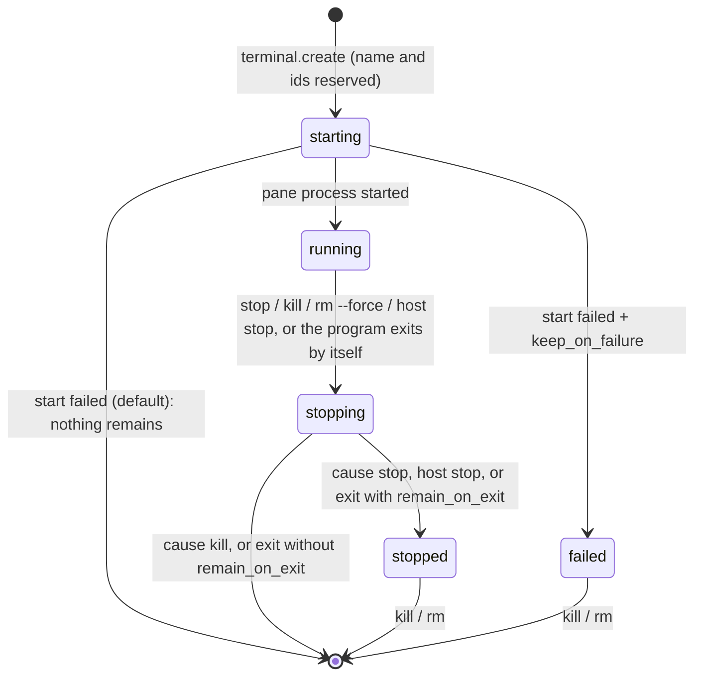

# Subak session model

Status: **current** (implemented in Step 10, pane programs and environment in Step 11; Windows only) · Decisions:
[ADR 0020](adr/0020-terminal-session-lifecycle.md), [ADR 0007](adr/0007-object-identity-and-naming.md),
[ADR 0003](adr/0003-subak-host-process-model.md), [ADR 0004](adr/0004-pty-and-process-ownership.md),
[ADR 0009](adr/0009-gui-clients-and-keyboard-dispatch.md) · Requirements: `SUBAK-FR-002`,
`SUBAK-FR-003`, `SUBAK-FR-010`…`SUBAK-FR-016`, `SUBAK-SEC-001`

This document states what a Terminal is inside the Host, which states it goes through, how it is
named and addressed, and what every action does to its processes. The wire format is in
[IPC_PROTOCOL §4](contracts/IPC_PROTOCOL.md); the code is `crates/subak/src/session.rs` (the
model, names, targets and the state machine) and `crates/subak/src/host.rs` (pseudo consoles,
jobs, threads and events).

## 1. Objects and identity

A Terminal is a named workspace owned by exactly one Host. It contains Windows, a Window contains
Panes, and each Pane runs one root process with its descendants:

| Object | Id | Human name | Owns |
| --- | --- | --- | --- |
| Terminal | `t-` + 12 lowercase hex | unique per Host (§3) | ≥ 1 Window; `remain_on_exit`; its lifecycle state |
| Window | `w-` + 12 hex, index from 0 | automatic: the program's file name (`cmd`) | ≥ 1 Pane; layout; active pane |
| Pane | `p-` + 12 hex, index from 0 | — | one pseudo console (ConPTY), one kill-on-close job, an output ring, a data stream id; its program, environment and I-O: [PTY_PROCESSES](PTY_PROCESSES.md) |

- **Until Steps 21–22 every Terminal has exactly one Window with exactly one Pane.** The model,
  the ids and the targets already have the three levels, so nothing changes for clients when
  splits and more windows arrive.
- **Isolation.** Each Pane has its own pseudo console and its own job object (ADR 0004). Ending
  one Terminal's job never touches another Terminal's processes. Measured: killing a Terminal
  ended its shell and a `ping` it had started, while a second Terminal's shell and `ping` kept
  running (`zero_one_and_many_terminals_have_isolated_process_trees`).
- **Ids** are random 48-bit values. The Host remembers every id it has issued and never issues one
  again, even after the object was removed. Across Host restarts, uniqueness rests on the 48 bits
  until Step 29 persists the issued ids. A pid is a volatile hint, never an identity.
- **Order.** Terminals are listed in creation order, which is the order of GUI tabs.
- **Limit.** A Host owns at most 256 Terminals (live and stored); more get `busy`.

## 2. Lifecycle state machine

One state machine applies to every Terminal. `session::next` is this table; the Host changes a
state in no other way, and emits the event in the same critical section as the change.

| State | Meaning | Live (keeps the Host) | Allowed |
| --- | --- | --- | --- |
| `starting` | Ids and name reserved; the pane process is being started (milliseconds) | yes | info, list, rename. stop/kill/rm answer `invalid_state` ("try again") |
| `running` | The pane process runs | yes | attach, input, resize, rename, stop, kill, rm `--force` |
| `stopping` | Its processes are being ended (§4) | yes | info, list, rename; a second stop waits for the same teardown; a kill escalates it |
| `stopped` | Kept without a process: stopped explicitly, or exited with `remain_on_exit` | no | info, list, rename, kill, rm |
| `failed` | Kept after its start failed (only with `keep_on_failure`); the reason is kept | no | info, list, rename, kill, rm |

What causes the end of a running Terminal decides where it goes. When several causes meet (a kill
during a graceful stop), the strongest wins: `kill` > `stop` > `exited` > `host stop`.

| Cause (`last_exit.cause`) | Started by | Then |
| --- | --- | --- |
| `stopped` | `terminal.stop` | `stopped` |
| `killed` | `terminal.kill`, `terminal.remove` with `force` | removed |
| `exited` | the pane's root process exited by itself | removed, or `stopped` with `remain_on_exit` (tmux semantics) |
| `host_stopped` | `host.stop` with `kill_terminals` (or the Host's idle exit, which happens only with no live Terminal) | `stopped`, then the Host exits |

Events (topic `terminals`, IPC_PROTOCOL §5): `terminal.created` (with the whole Terminal, state
`starting`), `terminal.state_changed` (`state`, `previous_state`, `cause`), `terminal.renamed`,
`terminal.removed` (`reason`: `killed`, `removed`, `exited`, `spawn_failed`, `host_stopping`), and
`pane.exited` (topic `panes`, after the pane's last output). A failed start emits `created` and
then `removed` (or `state_changed` to `failed`), so a client that saw the Terminal also sees it go.

`restorable` and `unknown` (ARCHITECTURE §4.2) belong to persistence and recovery (Steps 29–30)
and are not produced yet.

## 3. Names and targets

**Terminal names** (ADR 0007, refined by ADR 0020):

1. The name is Unicode-NFC-normalized, then trimmed. What remains must have 1–64 characters.
2. Not allowed: control characters, invisible formatting characters that could make two names look
   alike (bidirectional overrides, zero-width characters, the byte order mark, line and paragraph
   separators, soft hyphen), `:` and `.` (they separate the parts of a target), a leading `-` (it
   would read as an option), and anything shaped like an id (`t-`/`w-`/`p-` + 12 hex digits, in any
   case). Violations are `invalid_name` (CLI exit 2).
3. **Uniqueness ignores case and composition.** Two names collide when their keys are equal: the
   NFC form, lowercased with the locale-independent Unicode mapping, NFC-normalized again. So
   `Work`, `work`, `WORK` and ` Work ` are one name, and a Hangul name typed composed (`서버`) or
   decomposed equals itself. The case the user typed is kept for display.
4. A collision is `name_conflict` (CLI exit 7) with `details.existing` naming the holder.
   **Nothing is ever renamed or suffixed silently**, so scripts see the conflict.
5. Without a name, a Terminal gets the lowest positive integer no Terminal uses as its name (`1`,
   `2`, …); a freed number is reused. An explicit numeric name takes that number away from the
   default rule.
6. **Rename** keeps the id, the processes and every attachment. Changing only the case of one's
   own name is allowed. Renaming to another Terminal's name is `name_conflict`.
7. Name checks and reservations happen under the Host's single lock: of several concurrent
   creates or renames to one name, exactly one succeeds (measured with 8 concurrent creates and
   with mixed concurrent renames and creates).

**Targets** (ADR 0007): `<terminal>[:<window>[.<pane>]]`, or an id alone. The Terminal part is a
name or a `t-` id, the window an index, a name (window names need not be unique: several matches
are `ambiguous_target`) or a `w-` id, the pane an index or a `p-` id. Names match exactly,
ignoring case as above; nothing matches by prefix. `terminal.*` operations take only a Terminal
(name or `t-` id): a pane or window id there is `invalid_params`, so no command ends a whole
Terminal through a pane reference. `pane.attach` takes any level (a Terminal or Window means its
active pane), or no target when the Host has exactly one running pane (`ambiguous_target` with the
candidates otherwise). The CLI targets the confirmed Terminal **by id** after asking, so a rename
between the question and the action cannot redirect it.

## 4. Actions and what they do

These meanings are fixed. No action has two of them, and there is deliberately **no `close`**
command or IPC method: "close" in a UI is always one of the rows below.

| Action | CLI / IPC | Processes | Stored Terminal | Consent |
| --- | --- | --- | --- | --- |
| Detach a client | `Ctrl+B d`, end of piped input / `pane.detach` | untouched | untouched | none |
| A client disconnects or crashes; a console window running `subak terminal attach` is closed | — | untouched | untouched | none |
| Close a GUI window, quit the GUI, a GUI crash (Steps 16–18) | detach | untouched | untouched | none |
| Close a GUI **tab** with its × or "Hide tab" (Steps 16–18) | detach of that tab's panes | untouched | untouched; still listed in the session manager | none |
| **Stop**: end the processes, keep the Terminal | `subak terminal stop` / `terminal.stop` | graceful, then a guarded force (below) | kept as `stopped` | CLI: ask or `--yes` while it runs. Host: `force` when busy |
| **Kill**: end the Terminal | `subak terminal kill` / `terminal.kill`; GUI `Ctrl+W` "Close Terminal" | ended at once (`TerminateJobObject`) | removed | CLI: ask or `--yes`, always. Host: `force` when busy |
| **Remove** a Terminal that runs nothing | `subak terminal rm` / `terminal.remove` | none (a running one is refused: `invalid_state`) | removed | CLI: ask or `--yes` (it deletes the record) |
| Remove a running Terminal | `subak terminal rm --force` / `terminal.remove` with `force` | as kill | removed | as kill |
| Stop the Host | `subak host stop` / `host.stop` | every live Terminal ends as `host_stopped` | gone with the Host (until Step 29) | refused with live Terminals unless `--kill-terminals` (`terminals_running`), then ask or `--yes`; IPC `kill_terminals` |
| The program exits by itself | — | already ended; leftovers in its job are ended | removed, or `stopped` with `remain_on_exit` | — |

- **Graceful, then a guarded force** (stop, host stop): `ClosePseudoConsole` sends
  `CTRL_CLOSE_EVENT` to the processes attached to the pseudo console, the Host waits up to 5 s for
  the root process, and only then terminates whatever is left in the pane's job. The force step
  happens only inside a stop someone consented to, and is reported (`forced: true`). Measured on
  Windows 10 19045: an idle `cmd.exe` ends gracefully with `0xC000013A` (`forced: false`); a
  `ping` started in the background with `start /b` ended with the same stop.
- **Immediate** (kill, rm `--force`): the job is terminated first, then the pseudo console closed.
- **Busy.** A Terminal is busy when it runs more than an idle shell: its root program is not a
  known shell (`cmd`, `powershell`, `pwsh`, `bash`, `sh`, `zsh`, `fish`, `nu`), or its job holds
  more than one process. The Host refuses to stop, kill or force-remove a busy running Terminal
  without `force` (`busy`, CLI `confirmation_required`), with the processes in `details`. This is
  the Host-side guard against a client that decided "idle" a moment too early (ADR 0009's `Ctrl+W`
  rule): an idle shell may be closed without a question, anything else needs a confirmation. The
  rule is a heuristic over the job; a shell that waits in the foreground for a child shows as busy,
  which errs on the safe side.
- **The CLI is stricter than the Host**: `stop`, `kill` and `rm` are `destructive`
  (CLI_CONTRACT §4) and always ask, or need `--yes` when they cannot ask, also for an idle shell.
  Only after that consent does the CLI send `force`. `--dry-run` shows the plan (`busy`,
  `processes`, `ends_processes`, `removes_terminal`) and changes nothing.
- **One teardown.** Ending a pane is claimed once under the lock. Whoever claims it (a stop, a
  kill, a Host stop, or the pane's own exit waiter) performs it; anyone arriving later waits for
  the same result. A kill that arrives during a graceful stop terminates the job at once and
  decides the outcome (removed). Measured: a stop and a kill sent at the same moment by two clients
  always end with the Terminal removed and no process left; two simultaneous stops share one
  teardown.

## 5. Discovery and IPC operations

`terminal.list {detail: "summary" | "full"}`, `terminal.info {target}`, `terminal.create {name?,
command?, cwd?, env?, size?, remain_on_exit?, keep_on_failure?, dry_run?}` (`env` since Step 11;
what runs in a pane and with which environment is in [PTY_PROCESSES.md](PTY_PROCESSES.md)),
`terminal.rename {target,
name, dry_run?}`, `terminal.stop | terminal.kill {target, force, dry_run}` and
`terminal.remove {target, force?, dry_run}` are part of IPC v1 (an additive change; their shapes and
results are in IPC_PROTOCOL §4.3 and typed in `ipc-v1.schema.json`). `cli` and `gui` clients may
call all of them; `mcp` clients may only list and inspect until Step 37; `hook` clients none.

- **Consistent views.** Every change and its event are made in one critical section, and a
  connection receives responses and events in order. A client that first subscribes to
  `terminals` and then lists sees every later change exactly once, after the list.
- **Client crashes leave no stale state.** A connection owns nothing but its subscriptions and
  attachments; when it disappears, they go. A create whose client vanished mid-request completes
  in the Host and is listed normally (measured).
- **Failed creates leave nothing behind.** The name is released, the pseudo console and job of a
  failed start are closed, and no record remains unless `keep_on_failure` asked for a `failed` one.
  Measured: 20 failed starts (missing program, program not on `PATH`, missing working directory, a
  file as working directory) left no Terminal, no `conhost.exe`, no child of the Host, and a
  handle count within 12 of where it started. `spawn_failed` carries `details.reason`
  (`not_found`, `access_denied`, `bad_cwd`, `not_executable` since Step 11, `other`). Since
  Step 11 the Host decides most failures before it creates a pseudo console at all, so they leave
  not even the handle Windows 10's ConPTY keeps per pseudo console (30 failures of 10 kinds: Host
  handles 81 → 83, [PTY_PROCESSES §9](PTY_PROCESSES.md)).
- **A Host stop racing a create**: a pane that finishes starting after the stop began is ended at
  once and its Terminal removed (`reason: host_stopping`); nothing outlives the Host, because every
  pane job is kill-on-close.

The CLI (`subak terminal new|list|info|rename|attach|stop|kill|rm`, CLI_CONTRACT §6) maps onto
these methods. Only `terminal new` starts a Host on demand (with no Terminal of its own,
ADR 0019 §5); `terminal list` without a Host lists nothing and starts nothing.

## 6. Not implemented yet (and where it goes)

- **Persistence (Step 29).** Nothing is written to `state.json` yet. Terminals end with their Host
  (logoff, reboot, `host stop --kill-terminals`, a crash), and `stopped` or `failed` records are
  forgotten when the Host exits. A Host with only stored Terminals and no client idles out after
  its grace period, because stored Terminals are not live (ADR 0003 §4).
- **Restore and respawn (Step 30).** A `stopped` Terminal cannot be started again yet; remove it
  and create a new one.
- **Profiles** (`profile` of `terminal.create`, Step 33) are refused with `invalid_params`, never
  silently ignored. Environment overrides (`env`) exist since Step 11
  ([PTY_PROCESSES §3](PTY_PROCESSES.md)).
- **More windows and panes** (Steps 21–22), the GUI's tabs and session manager (Steps 16–18), and
  `pane.send_keys` / `pane.capture` (Steps 12–13).

## 7. Evidence

Automated, on real Windows 10 Pro 19045 with real `subak.exe` Hosts on private endpoints
(`crates/subak/tests/session_lifecycle.rs`; unit tests of names, targets and the state machine in
`crates/subak/src/session.rs`; the e2e scenario `e2e/tests/step10_session_lifecycle.rs`):

| Test | What it shows |
| --- | --- |
| `zero_one_and_many_terminals_have_isolated_process_trees` | 0, 1 and 5 Terminals, one `conhost.exe` each, creation order, default names, events, isolation of process trees |
| `names_are_unique_ignoring_case_and_composition_and_renames_keep_ids` | collisions with case and NFC, invalid names, renames that keep id and pid, targets |
| `concurrent_clients_create_and_rename_without_duplicates_or_orphans` | 8 concurrent creates of one name → one Terminal; 6 unnamed → `1`…`6`; racing renames and a create → one holder; a client killed mid-create |
| `failed_creations_leave_no_pty_job_process_or_record` | 20 failed starts leave nothing; `keep_on_failure` and `rm` |
| `stop_kill_and_rm_have_distinct_explicit_guarded_meanings` | the busy guard, CLI consent, `rm` refusing a running Terminal, stop keeps / kill removes, the stop–kill race |
| `detach_disconnect_and_client_crash_never_stop_a_terminal` | GUI-style attach and disconnect, explicit detach, `Ctrl+B d`, a killed client, reconnect with replay: zero lifecycle events |
| `exits_restarts_and_reconnects_leave_no_stale_state` | exit removes, `remain_on_exit` keeps, reconnects see one state, `host stop` needs `--kill-terminals`, a new Host starts clean |
