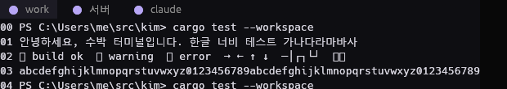
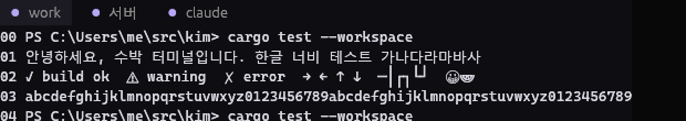

# GUI technology evaluation (Step 04)

Evidence for [ADR 0014](../../docs/adr/0014-gui-technology.md). This is a **standalone Cargo
workspace**: it is not a member of the Kim workspace, not built by CI, and nothing here ships.

## Prototypes

| Binary | Stack | What it draws |
| --- | --- | --- |
| `eval-winit` | winit 0.30.13 + softbuffer 0.4.8 (CPU) | Clears the window; no text. Lower bound for "a native window exists". |
| `eval-egui-glow` | eframe/egui 0.37.0, glow (OpenGL) renderer, AccessKit on | Kim-styled tab bar + 24 lines of ASCII, Korean, symbols, emoji. |
| `eval-egui-wgpu` | eframe/egui 0.37.0, wgpu 30.0.1 renderer, AccessKit on | Same as above. |

All windows are created **off-screen, not activated and without a taskbar entry**, so measuring
does not disturb the person using the machine. They repaint reactively (only on events) and
exit after N seconds.

## Reproduce

```powershell
# from research/gui-eval, with the toolchain from the repository root
cargo build --release -p eval-winit;                      copy target\release\eval-winit.exe bin\
cargo build --release -p eval-egui --features glow;       copy target\release\eval-egui.exe bin\eval-egui-glow.exe
cargo build --release -p eval-egui --features wgpu;       copy target\release\eval-egui.exe bin\eval-egui-wgpu.exe
powershell -NoProfile -File measure.ps1 -Runs 3           # writes results.json
# glyph rendering evidence (framebuffer read-back, no visible window):
$env:EVAL_FALLBACK = "malgun";                         bin\eval-egui-glow.exe 4 --screenshot default.bmp
$env:EVAL_FALLBACK = "cascadia,malgun,symbol,emoji";   bin\eval-egui-glow.exe 4 --screenshot fallback.bmp
```

`measure.ps1` starts each binary, waits 8 s for start-up to settle, then samples process CPU
time and memory across a 30 s idle window (3 runs each).

## Results (2026-11-03)

Machine: Intel Core i5-13600KF, 32 GB RAM, NVIDIA GeForce RTX 4070 Ti (driver 581.15),
Windows 10 Pro 22H2 build 19045, rustc 1.99.1 `x86_64-pc-windows-gnu`, release profile (thin
LTO, stripped). Raw data: [results.json](results.json).

| Stack | Binary | First frame (ms) | Idle CPU over 30 s | Working set (MiB) | Private (MiB) | Threads | Handles |
| --- | --- | --- | --- | --- | --- | --- | --- |
| winit + softbuffer | 645 KiB | 15–23 | 0 ms (below 15.6 ms timer resolution) | 13.1–13.7 | 4.6–4.7 | 5 | ~202 |
| egui + glow | 5.7 MiB | 171–280 | 0 ms | 69.3–69.4 (124.9 on the first, cold run) | 97.6–97.8 (149.7 cold) | 12 | ~361 |
| egui + wgpu | 11.0 MiB | 1593–1864 | 0 ms | 301.5–338.5 | 596–612 | 66 | ~1004 |

Observations:

- **Idle CPU is zero for all three**: reactive repainting works; no stack polls when idle.
- **Memory is dominated by the GPU driver stack**, not by Rust or egui: the GL context adds
  ~55 MiB working set over a bare window; the wgpu (DX12) device adds ~290 MiB, plus 54 threads.
- **Start-up**: glow ~0.17 s, wgpu ~1.6 s to first frame.

### Glyph rendering (egui text stack)

| Default egui fonts + Malgun Gothic | Fallback chain Cascadia Mono → Malgun Gothic → Segoe UI Symbol → Segoe UI Emoji |
| --- | --- |
|  |  |

- Korean renders through the Malgun Gothic fallback.
- With only the default fonts, symbols (`✓ ⚠ ✗`), box drawing and emoji are missing (tofu).
- With the token fallback chain, symbols and box drawing render, but **emoji are monochrome
  outlines** (egui's rasterizer has no color-font support) and egui's label layout uses natural
  advances, so **Hangul is not aligned to a 2-cell grid**. A terminal needs a cell-grid renderer
  with its own shaping/fallback/color-glyph path.

## Not measured (and why)

- **iced**, **Slint**, **native Win32 + Direct2D/DirectWrite**: assessed from documentation and
  licenses in the ADR; measuring them is warranted only if the chosen path fails its triggers.
- **Input latency**: needs an interactive harness with a real PTY (Steps 15–16).
- **RDP / VM / no-GPU behavior**: not available on this machine; tracked as risk R-14.
